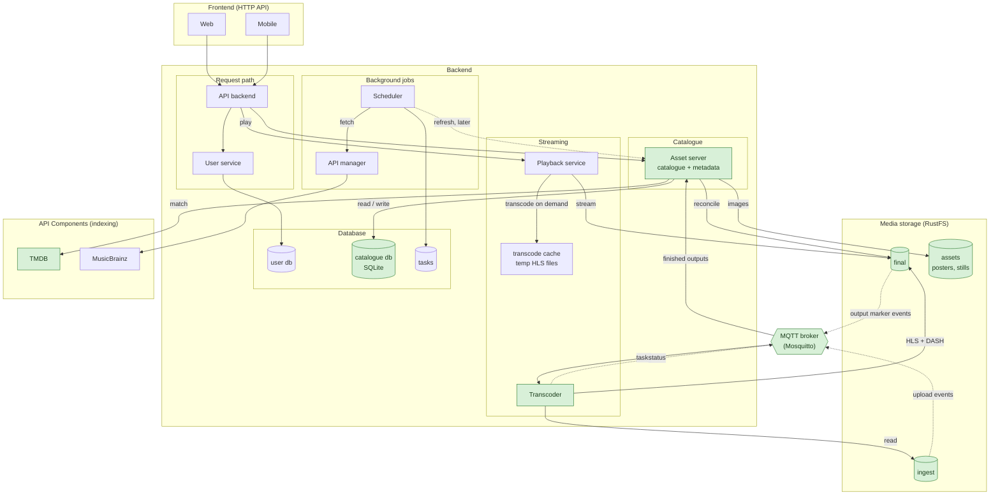

Green parts are built; the rest is planned. The **Asset server** combines the planned Library and
Metadata services (see [Asset server](asset-server.md)).

**Media storage** is S3-compatible object storage (RustFS); new uploads reach the Transcoder, and
finished outputs (their `source.json` in `final`) the Asset server, as events over an MQTT broker
(Mosquitto). See [Infrastructure](infrastructure.md), and
[Setup](setup.md) for a development environment.
