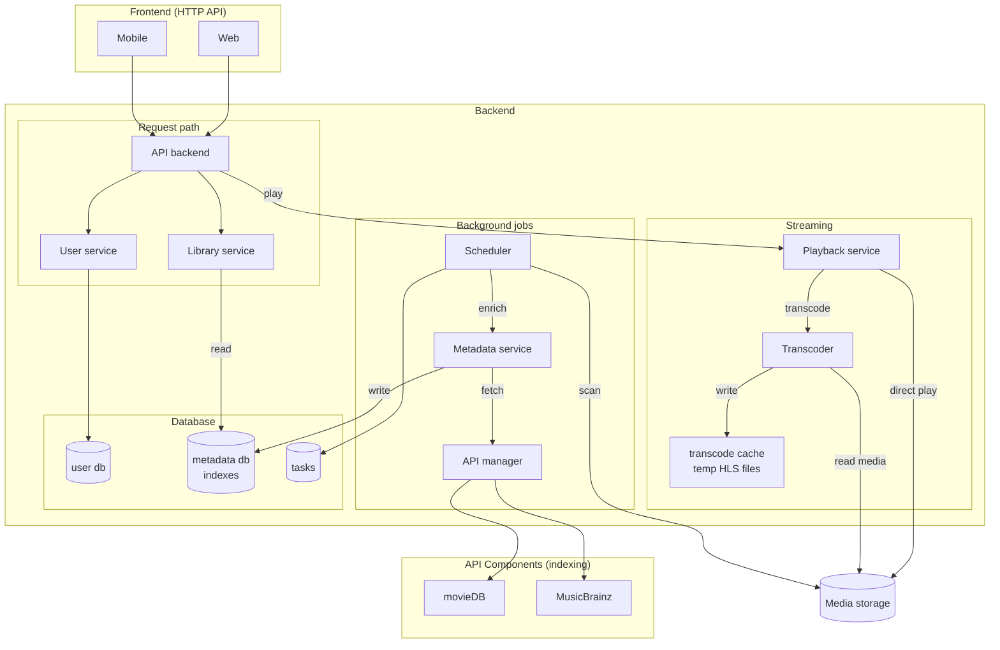

**Media storage** is S3-compatible object storage (RustFS); new uploads reach the Transcoder as
events over an MQTT broker (Mosquitto). See [Infrastructure](infrastructure.md), and
[Setup](setup.md) for a development environment.
