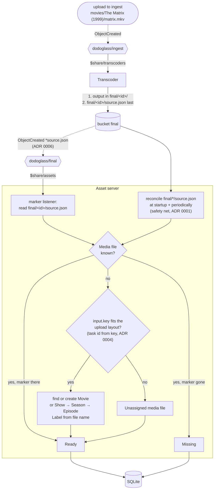
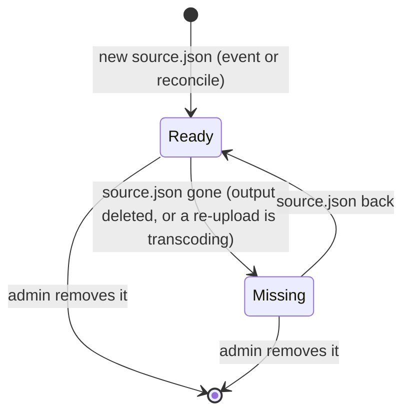
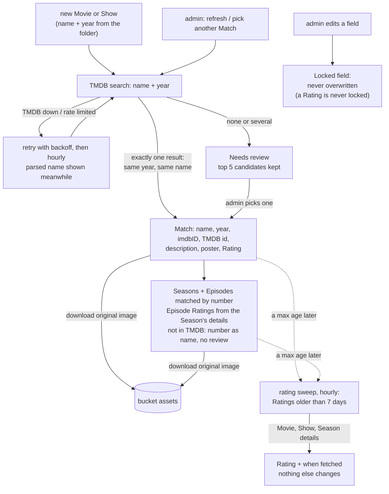
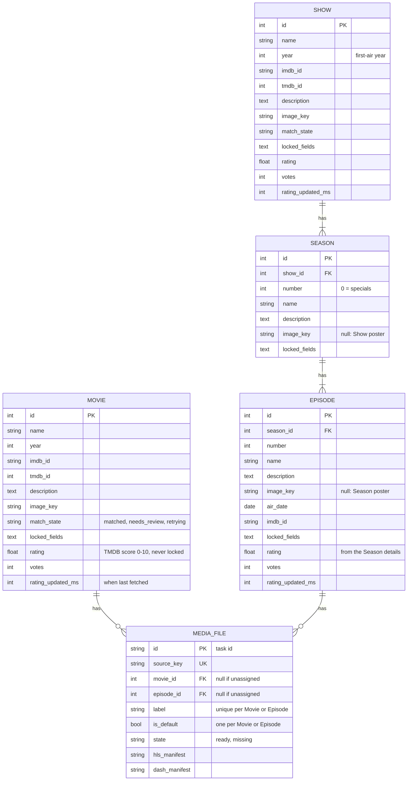

# Asset server

**Status: partly built.** See [Built so far](#built-so-far).

The asset server owns the **catalogue**: which Movies, Shows, Seasons and Episodes exist, their
descriptive information (name, year, imdbID, description, image, Rating) and which Media files
belong to them. It plays both the *Library service* and the *Metadata service* of the
[system architecture](architecture.md); they can be split later if enrichment needs its own scaling.

Terms are defined in `GLOSSARY.md` at the repository root; the decisions behind this page are recorded
in `docs/adr/` (ADR 0001–0006).

| | |
|---|---|
| Source | `application/asset-server/` (Rust, axum, Diesel) |
| Database | SQLite through Diesel; Postgres later (ADR 0002). Until then only **one** instance may run |
| Metadata | [TMDB](https://www.themoviedb.org), one configurable language (default `en-US`) |
| Images | bucket `assets`, original size from TMDB |
| Runs | natively, `go-task` task, like the transcoder; migrations run at startup |

## Built so far

The tracer bullet (a Movie upload becomes listable), then Shows, TMDB metadata and Ratings.

- **Marker listener** on `$share/assets/dodoglass/final` (ADR 0006): RustFS publishes every new
  `<id>/source.json` in `final` there (QoS 1). The listener reads the standard S3 part of each
  event, URL-decodes the keys (RustFS sends `abc%2Fsource.json`), handles several records per
  message and ignores any other object. It reads the marker from `final` and places its Media file
  as **Ready**, or makes a known one Ready again, then acknowledges the message; one that could not
  be stored is not acknowledged and comes again. Handling the same marker twice changes nothing
  (delivery is at least once). An unreadable marker is acknowledged and left to the reconcile's
  warnings. The asset server does not listen to `dodoglass/ingest` or `dodoglass/status`, and does
  not read `ingest` at all.
- **Placement of Movies:** the marker's `input.key` `movies/<Name> (<Year>)/<label>.<ext>` creates
  the Movie (or finds it) and a Ready Media file whose id is the shared crate's task id. The key is
  read in NFC for placing and for the id (so NFC and NFD spellings are the same Movie and Media
  file), but stored as uploaded: S3 keys are byte-exact, and the admin API shows the real path. A
  re-upload under the other spelling stores that spelling.
- **Placement of Episodes:** `shows/<Name> (<Year>)/Season <n>/S<nn>E<nn>…` (or `Specials/`, Season
  0) finds or creates the Show (by folder name and year), its Season (by number) and its Episode (by
  number), and a Ready Media file attached to the Episode. Every other path is stored without a
  Movie or Episode (Unassigned), also Ready.
- **Several Media files per Movie:** each one's Label is its file name without the extension, made
  unique within the Movie (`matrix.mkv` + `matrix.mp4` → "matrix", "matrix (mp4)"; a number is
  added if that is taken too). The first one placed is the **Default media file**. A re-upload to
  the same path keeps the id, Label and default flag; it is **Missing** while the transcoder
  replaces its output (the old marker is deleted first) and Ready again with the new marker. Labels
  and the default are kept per *owner* of the Media file (`media_file.is_default`, unique indexes
  per owner), so Movies and Episodes follow the same rules. The stored default only moves when the
  default is **removed**: the oldest remaining Ready Media file (by first placing) takes over, or,
  with none, the oldest remaining one whatever its state. While the default is Missing, the read
  API marks the oldest Ready Media file as default instead, without storing it; once the default is
  Ready again it is the default again.
- **Reconciler**, the safety net for lost events (ADR 0001): at startup and every
  `--reconcile-interval` seconds (default 300) every Media file is checked against
  `final/<id>/source.json`; the marker listener runs the same check for one Media file. Its
  manifest keys follow the `formats` in the marker.
  - a Ready Media file whose marker is gone becomes **Missing**, and Ready again when it is back;
    it is never deleted automatically;
  - a Missing one whose marker is there becomes Ready (the marker is the source of truth);
  - a folder in `final` with no Media file is placed from the `input.key` of its marker, as Ready,
    if that key gives the folder's id.
- **Not in the catalogue:** uploads still transcoding or whose transcode failed. They show in the
  transcoder's status messages and as inputs left in `ingest` (ADR 0006).
- **Read API:** `GET /movies` lists the Movies that are not Hidden, with their Ready Media files:
  `[{"id", "name", "year", "media_files": [{"id", "label", "default", "manifests": {"hls", "dash"}}]}]`,
  the Media files ordered by Label. A matched Movie also has `tmdb_id`, `imdb_id`, `description`
  and `image` (left out when unknown).
  `GET /shows` → `[{"id", "name", "year"}]`, plus `tmdb_id`, `imdb_id`, `description`, `image`
  once matched. `GET /shows/{id}/seasons` → `[{"number", "name", "description", "image"}]`,
  `GET /shows/{id}/seasons/{number}/episodes` → `[{"number", "name", "tmdb_id", "imdb_id",
  "description", "image", "air_date", "media_files": [...]}]` (Media files as for Movies; fields
  TMDB did not give are left out). Movies, Shows and Episodes always have `rating` (TMDB's score,
  0–10), `votes` and `rating_updated_at` (RFC 3339, UTC, e.g. `"2026-11-17T00:00:00Z"`), all `null`
  without a Rating: no Match, or no votes on TMDB yet. Seasons have none. A Season or Episode TMDB does not name is "Season 2" /
  "Specials" / "Episode 3". `image` falls back: a Season without a poster has its Show's, an
  Episode without a still its Season's (so, failing that, its Show's). Hidden applies at every level: an Episode needs a Ready Media file, a Season a listed
  Episode, a Show a listed Season; a Hidden or unknown Show or Season answers 404. Missing Media
  files are not listed; `default` is as described above (the oldest Ready one while the stored
  default is Missing).
- **Unassigned media files:** a finished upload outside the layout is stored without a Movie or
  Episode, Ready or Missing like any other, and is never in the read API.
- **TMDB for Movies and Shows** (the *matcher*): each new Movie or Show is looked up once,
  searching by its folder's name and year (`/search/movie`, `/search/tv` with the first-air year). Exactly one result with that year and the same name (ignoring case and punctuation)
  is a **Match**: name, year, imdbID, TMDB id, description and poster are filled in, except
  **Locked fields**, and the **Rating** (`vote_average`, `vote_count`), which is never locked. Otherwise **Needs review** with the top 5 results kept as candidates. While TMDB
  is unreachable or rate limiting (429, 5xx), the lookup is retried after 30 s, doubling up to 1 h,
  then hourly for as long as the outage lasts: an outage never fills Needs review. The entry stays
  `retrying` and shows its folder's name and year meanwhile. A
  pass runs every `--tmdb-interval` seconds (default 10): Movies, then Shows, then the Seasons and
  Episodes of matched Shows, so a Show's Match fills them in the same pass. The port (`Tmdb` trait,
  reqwest client, v3 API key or v4 token, `--tmdb-language` default `en-US`) has `search_movie`,
  `movie`, `search_tv`, `tv`, `season`, `episode` and `image`; Show and Episode imdbIDs come from
  `append_to_response=external_ids`. Without `--tmdb-api-key` no lookups run.
- **Seasons and Episodes** of a matched Show are looked up by number (`/tv/{id}/season/{n}`,
  `/tv/{id}/season/{n}/episode/{e}`), with no search and no Needs review. A Season gets name,
  description and poster, an Episode name, description, still, air date, TMDB id and imdbID, and
  its Rating from the Season's details, which list every Episode with its score: a pass fetches
  each Season once and shares it with its Episodes, so no Episode costs a request for its Rating.
  One TMDB does not know (404, common for specials) keeps its number as its name. While TMDB is
  unavailable they keep their numbers and are retried with the same backoff, hourly once it is
  capped, until TMDB answers.
  One that appears later under a matched Show is looked up by the next pass, without searching the
  Show again. A Show in Needs review leaves its Seasons and Episodes unlooked-up until it has a
  Match.
- **Images:** a matched Movie's, Show's or Season's poster and an Episode's still are downloaded
  once, in its original size, to
  `assets/posters/<TMDB file name>`; `GET /images/<key>` streams it. Browsing never calls TMDB.
- **Admin API** (under `/admin`, no authentication, localhost only):
  `GET /admin/media-files/<id>` → `{"id", "key", "label", "state"}` (`key`: the upload key its
  marker records; `state`: `ready` or `missing`), 404 for an unknown id.
  `GET /admin/media-files?state=missing` → the same for every Missing Media file, by key (every
  Media file without `state`). 400 for any other `state`: Processing and Failed are not in the
  catalogue.
  `PUT /admin/media-files/<id>/default` makes a Ready Media file the default of its Movie or Episode
  (204; 409 if it is not Ready or is Unassigned).
  `PATCH /admin/media-files/<id>` with `{"label"}` renames its Label (204; 409 if another Media file
  of the same Movie or Episode has it, 400 if empty).
  `DELETE /admin/media-files/<id>` removes it: `final/<id>/` is deleted through the storage port
  (`source.json` first, so a removal cut short never leaves a marker for the reconciler to place
  again), then its row. Its Movie or Episode stays, Hidden if nothing Ready is left, with its
  metadata and Locked fields; a new upload brings it back once transcoded.
  `DELETE /admin/movies/<id>`, `/admin/shows/<id>`, `/admin/shows/<id>/seasons/<n>` and
  `/admin/shows/<id>/seasons/<n>/episodes/<n>` delete a **Hidden** entry for good, with what is below
  it, its metadata and its Media files (and their output in `final`); 409 if it is not Hidden. The
  same folder uploaded again is a new entry, looked up in TMDB again.
  `GET /admin/needs-review` → `{"movies": [{"id", "name", "year", "candidates": [{"tmdb_id",
  "name", "year", "description", "poster_path"}]}], "shows": [...]}` (Shows in the same shape).
  `GET /admin/unassigned-media-files` → `[{"id", "path", "reason", "state"}]` by path, the reason
  taken from the path (`no_year`, `unknown_root_folder`, `wrong_depth`, `unsupported_extension`,
  `unknown_season_folder`, `no_episode_code`, `season_mismatch`).
  `POST /admin/unassigned-media-files/{id}/attach` with `{"movie": {"name", "year"}}` or
  `{"episode": {"show", "year", "season", "number"}}` (folder names and years, as in the upload
  layout) attaches it to that existing Movie or Episode → `{"id", "label"}`. The Label follows the
  upload rule ("matrix (mkv)" if "matrix" is taken); it becomes the default only if the owner had no
  Media file. 404 if the Media file is not Unassigned or the target does not exist. A re-upload to
  the same path keeps it attached. With `{"new_movie": {"tmdb_id"}}` or `{"new_episode":
  {"tmdb_id", "season", "number"}}` it is attached to a new Movie, or an Episode of a new Show,
  created from TMDB with that Match; its folder is TMDB's name and year, so later uploads to
  `movies/<name> (<year>)/` join it (an existing entry with that folder is used, and matched unless
  it has a Match). A Show's Seasons and Episodes are looked up at once. 400 if TMDB does not know the
  id, 503 if TMDB is unavailable; nothing is created then.
- **Metadata corrections** (admin API; paths as in the read API):
  `PUT /admin/movies/<id>/match` and `PUT /admin/shows/<id>/match` with `{"tmdb_id"}` (a candidate's
  or any other) make it the **Match**: every field that is not locked is refilled and the entry
  leaves Needs review (204). For a Show whose Match changes, its Seasons and Episodes lose what they
  had from the old one (Locked fields kept) and are looked up again by number in the same request.
  `POST /admin/movies/<id>/refresh` and `/admin/shows/<id>/refresh` fetch the entry from TMDB again
  by its Match (a Show with its Seasons and Episodes), or search again as for a new entry if it has
  none. `POST /admin/shows/<id>/seasons/<n>/refresh` and `.../episodes/<n>/refresh` look one Season
  or Episode up again (409 if its Show has no Match). Errors: 404 unknown entry, 400 TMDB does not
  know the id, 503 TMDB unavailable.
  `PATCH /admin/movies/<id>`, `/admin/shows/<id>`, `/admin/shows/<id>/seasons/<n>` and
  `.../episodes/<n>` with fields to set (e.g. `{"description": "...", "year": 2000}`; `null` empties
  a field other than a Movie's or Show's name and year) set them and make them **Locked fields** →
  `{"locked_fields": [...]}`; 400 for a field the entry does not have or a wrong value.
  `DELETE <the same path>/locks/<field>` unlocks one → the Locked fields left; the next Match or
  refresh fills it from TMDB again. `rating`, `votes` and `rating_updated_at` are refused by both
  (400): the Rating is never a Locked field, and a refresh or Match updates it also on an entry
  with Locked fields. Edits show in the read API also before a Match. An entry edited
  before its first lookup is still looked up (its metadata row is created as due).
- **Rating sweep:** every `--rating-sweep-interval` (default 1 h) the Ratings older than
  `--rating-max-age` (default 7 days) are fetched again, oldest first, at most 20 entries per
  sweep. See [Keeping Ratings current](#keeping-ratings-current).
- **Database:** SQLite via Diesel, migrations in portable SQL run at startup. Tables so far: `movie`
  (with `folder_name`/`folder_year`, the placement identity, apart from the displayed `name`/`year`)
  and `media_file` (`state` is `ready` or `missing`; a migration removed Processing and Failed
  rows and the `error` column); `show` (same folder identity), `season`, `episode`, and `media_file.episode_id`
  (a `CHECK` keeps a Media file from having both a `movie_id` and an `episode_id`);
  `movie_metadata` (match state, retry backoff, TMDB fields, `locked_fields` as a JSON array of field
  names; no row = not looked up yet) and `movie_candidate`; `show_metadata` and `show_candidate`
  (the same for Shows), `season_metadata` and `episode_metadata` (`matched`, `not_found` or
  `retrying`, the TMDB fields, `locked_fields` in the same JSON-array shape; no row = not looked up
  yet). Lockable fields: Movie and Show `name`, `year`, `imdb_id`, `description`, `image`; Season
  `name`, `description`, `image`; Episode also `air_date`, `imdb_id`. A Match or lookup never writes
  a locked field. `movie_metadata`, `show_metadata` and `episode_metadata` also hold the Rating:
  `rating`, `votes` and `rating_updated_ms` (when it was last fetched; `NULL` for entries matched
  before Ratings existed, which the sweep then fetches first).

Not built yet: listing Hidden entries in the admin API (not part of the first spec).

**Running it:** `go-task infra:up`, `go-task transcoder:serve-s3`, `go-task asset-server:serve`
(HTTP on `127.0.0.1:8090`), then for example
`go-task infra:upload KEY="movies/The Matrix (1999)/matrix.mkv" -- application/transcoder/sample.mp4`
and `curl localhost:8090/movies` (set `ASSETS_TMDB_API_KEY` for metadata and Ratings). Settings: `go-task asset-server:serve -- --help`, all also as
`ASSETS_*` environment variables. Code layout and how to write tests:
`application/asset-server/README.md`.

## Upload layout

Where a video is uploaded in `ingest` decides what it is (ADR 0003). The year is **required**.

```
movies/<Name> (<Year>)/<label>.<ext>
shows/<Name> (<Year>)/Season <n>/S<nn>E<nn>[ anything].<ext>
shows/<Name> (<Year>)/Specials/S00E<nn>[ anything].<ext>
```

| Upload | Becomes |
|---|---|
| `movies/The Matrix (1999)/matrix.mkv` | Movie *The Matrix* (1999), Media file labelled "matrix" |
| `movies/The Matrix (1999)/matrix-directors-cut.mkv` | second Media file of the same Movie |
| `shows/Breaking Bad (2008)/Season 01/S01E02 - Cat's in the Bag.mkv` | Show *Breaking Bad* (2008), Season 1, Episode 2 |
| `shows/Breaking Bad (2008)/Specials/S00E01.mkv` | Season 0 (specials), Episode 1 |
| `movies/The Matrix/matrix.mkv` (no year), `misc/clip.mp4`, `Season 01/S02E01.mkv` | **Unassigned media file**, attached by an admin |

Nothing that is uploaded is rejected: what does not fit waits for an admin instead of being lost.

## How a Media file gets in



1. The transcoder writes `source.json` last, once the output is complete (ADR 0001). RustFS
   publishes that object's event on `dodoglass/final`, which only the asset server subscribes to
   (as its own shared-subscription group), so output never triggers a transcode.
2. The asset server reads the marker from `final`: `source.json` records the input as `{bucket,
   key}`, and the key places the Media file (or makes it an Unassigned media file), **Ready** at
   once. The id is the **same task id** the transcoder uses, from a crate both depend on.
3. Events can be lost (the asset server was down, the broker restarted). The reconcile at startup
   and every few minutes finds what they missed, and notices markers that are gone (**Missing**).
4. What is still transcoding or has failed is not in the catalogue: it shows in the transcoder's
   status messages and as inputs left in `ingest`.

### Media file states



- The catalogue only learns of a Media file once its transcode is complete (ADR 0006), so there is
  no Processing or Failed state and no time limit.
- Uploading to the **same path** again is a new version of the same Media file: the transcoder
  deletes the old marker first, so it is Missing until the new one is written. Its Movie or
  Episode, Label and Locked fields stay, and so does its place as the Default media file.
- Only an admin removes a Media file; the asset server then deletes `final/<id>/` and the row. Output
  that disappears for any other reason makes it **Missing**, never deleted.
- A Movie or Episode without a Ready Media file is **Hidden**, not deleted, so a re-upload comes back
  with its fixes. Shows and Seasons are hidden when none of their Episodes are visible.
- One Media file per Movie or Episode is the **Default media file**. The stored default only moves
  when it is **removed**: the oldest remaining Ready one takes over (or the oldest remaining one).
  While it is Missing, the read API marks the oldest Ready one as default without storing that;
  once it is Ready again, it is the default again.
- **Labels** are unique per Movie or Episode: `matrix.mkv` and `matrix.mp4` become "matrix" and
  "matrix (mp4)". An admin can rename them.

## How imdbID, name, description, image and Rating get set



- **Automatic Match** only when exactly one TMDB result has the same year and the same name (ignoring
  case and punctuation). A wrong automatic Match is worse than one waiting for review.
- **Shows** are searched by first-air year. Their Seasons and Episodes follow by number, without a
  search or review of their own; picking another Match for the Show refills them too.
- **Fetched once**, when an entry first appears, and again only when an admin asks. The one
  exception is the **Rating**, which the rating sweep keeps current (see
  [Keeping Ratings current](#keeping-ratings-current)).
- **Locks are per field.** Picking another Match or refreshing refills every field that is not
  locked. The Rating is never locked: it is updated with every Match, refresh and sweep.
- **No image** on TMDB: none is stored. A Season falls back to its Show's poster, an Episode to its
  Season's. Placeholders are the frontend's job.

| Level | Fields from TMDB | Rating |
|---|---|---|
| Movie | name, year, imdbID, TMDB id, description, poster | `vote_average`, `vote_count` of its details |
| Show | name, first-air year, imdbID, TMDB id, description, poster | `vote_average`, `vote_count` of its details |
| Season | number, name, description, poster | none |
| Episode | number, name, description, still, air date, imdbID | from its Season's details, which list every Episode |

## Keeping Ratings current

Everything above is fetched once; a Rating changes all the time, so it is refreshed periodically
(ADR 0005). Each Movie, Show and Episode records when its Rating was last fetched.

- **The sweep** runs in the asset server every `--rating-sweep-interval` (`ASSETS_RATING_SWEEP_INTERVAL`,
  default `1h`), when a TMDB key is set. It takes the Ratings older than `--rating-max-age`
  (`ASSETS_RATING_MAX_AGE`, default `7d`), oldest first and never-fetched ones before all, at most
  20 entries per sweep.
- **One request per entry:** a Movie's or Show's details, or a Season's details for all its matched
  Episodes (they count as one entry). No request per Episode.
- **Only Ratings change:** names, descriptions, images and Locked fields stay as they are.
- **Only matched entries** have a Rating and are swept. Unmatched ones, and Episodes TMDB does not
  know, have `rating: null`.
- **TMDB unavailable** ends the sweep: the Ratings keep their value and timestamp, so they are still
  the oldest and the next sweep tries them first (an hour later by default, like the lookups'
  longest retry). Nothing goes to Needs review. TMDB refusing (it no longer knows the entry) keeps
  the Rating and records the attempt, so the entry waits a maximum age instead of blocking every
  sweep.
- **Cost:** about one request per Movie, Show and Season per maximum age.

Tests run a sweep explicitly (`TestApp::sweep_ratings`) after moving the fake clock past the
maximum age.

## Data model



A Media file belongs to a Movie **or** an Episode, or to neither while it is unassigned. The Default
media file is a flag on the Media file rather than a column on its owner, so Movies and Episodes share
one rule; partial unique indexes keep it to one per owner. Migrations
stay within SQL that SQLite and Postgres both accept (ADR 0002).

## API

**Read API** (for the frontends, through the API backend):

- Lists only entries that are not Hidden. Entries in Needs review are shown with the name and year
  from the folder, so a movie can be watched before its metadata is fixed.
- Movies, Shows and Episodes carry their Rating: `rating` (number or `null`), `votes` (integer or
  `null`) and `rating_updated_at` (timestamp or `null`).
- Per Media file (Ready ones only): its Label, whether it is the default (the stored default, or
  the oldest Ready one while that is Missing), and the **manifest keys**
  (`final/<id>/hls/master.m3u8`, `final/<id>/dash/manifest.mpd`). Delivering the streams is the
  Playback service's job.
- `GET /images/<key>` streams an image from `assets`.

**Admin API** under `/admin/...`: list Needs review and Unassigned media files, list Missing Media
files (`?state=missing`, the only state filter), pick a Match, edit fields (which locks them; the
Rating cannot be edited or locked), attach an Unassigned media file, set the Default media file,
rename a Label, remove a Media file (which hands the default over for good), refresh.

## Changes outside the asset server

| Where | Change |
|---|---|
| Transcoder | task id = readable prefix + 8 hex of SHA-256 over the NFC-normalised key (ADR 0004), moved into a shared crate |
| Transcoder | `source.json` stores `input` as `{"bucket": …, "key": …}`; its schema (`OutputMarker`) moved into the shared crate, so both read and write the same type |
| `infra/init.sh` | creates the bucket `assets`; sets the event rule on `final` (`source.json` → `dodoglass/final`, ADR 0006) |
| `final` bucket | existing outputs deleted and re-uploaded (new ids, no migration) |

## Open points

- **No authentication** on the admin API: reachable from localhost only, like the development setup
  of MQTT and RustFS. Real authentication comes with the User service.
- **One instance** while the database is SQLite.
- **Several languages** of metadata at once, **periodic refresh** of fields other than the Rating
  (episodes described after upload),
  **image resizing** and **typed attributes** of Media files (edition, audio language) are left for
  later.
