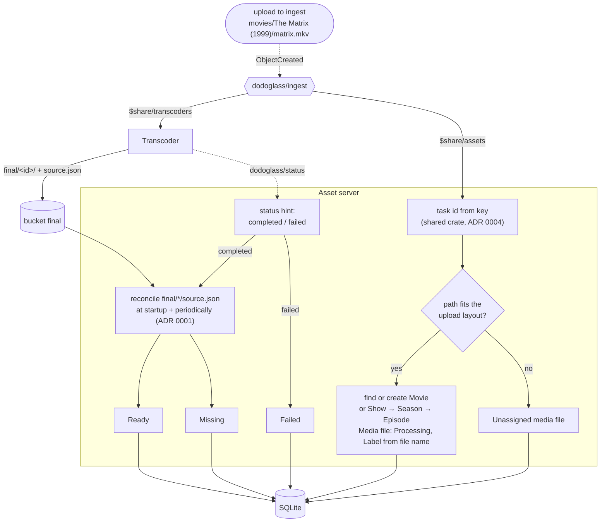
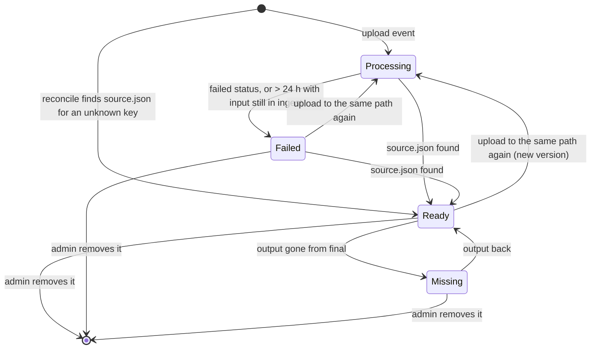
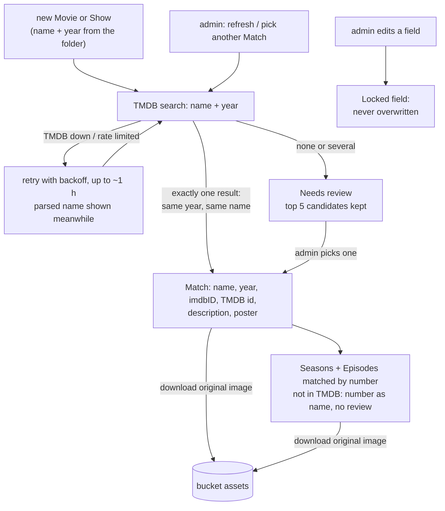
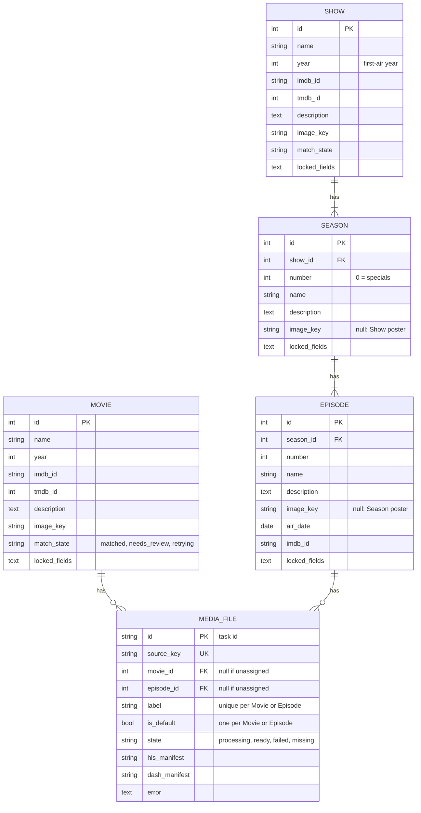

# Asset server

**Status: partly built.** See [Built so far](#built-so-far).

The asset server owns the **catalogue**: which Movies, Shows, Seasons and Episodes exist, their
descriptive information (name, year, imdbID, description, image) and which Media files belong to
them. It plays both the *Library service* and the *Metadata service* of the
[system architecture](architecture.md); they can be split later if enrichment needs its own scaling.

Terms are defined in `GLOSSARY.md` at the repository root; the decisions behind this page are recorded
in `docs/adr/` (ADR 0001–0004).

| | |
|---|---|
| Source | `application/asset-server/` (Rust, axum, Diesel) |
| Database | SQLite through Diesel; Postgres later (ADR 0002). Until then only **one** instance may run |
| Metadata | [TMDB](https://www.themoviedb.org), one configurable language (default `en-US`) |
| Images | bucket `assets`, original size from TMDB |
| Runs | natively, `go-task` task, like the transcoder; migrations run at startup |

## Built so far

The tracer bullet (a Movie upload becomes listable), then Shows.

- **Ingest listener** on `$share/assets/dodoglass/ingest`. It reads the standard S3 part of each
  event, URL-decodes the keys, handles several records per message, and acknowledges a message only
  after it is stored.
- **Placement of Movies:** `movies/<Name> (<Year>)/<label>.<ext>` creates the Movie (or finds it) and
  a **Processing** Media file whose id is the shared crate's task id. Keys are normalised to NFC.
- **Placement of Episodes:** `shows/<Name> (<Year>)/Season <n>/S<nn>E<nn>…` (or `Specials/`, Season
  0) finds or creates the Show (by folder name and year), its Season (by number) and its Episode (by
  number), and a Processing Media file attached to the Episode. Every other upload is stored without
  a Movie or Episode (Unassigned).
- **Several Media files per Movie:** each one's Label is its file name without the extension, made
  unique within the Movie (`matrix.mkv` + `matrix.mp4` → "matrix", "matrix (mp4)"; a number is
  added if that is taken too). The first one uploaded is the **Default media file**. A re-upload to
  the same path keeps the id, Label and default flag and goes back to Processing. Labels and the
  default are kept per *owner* of the Media file (`media_file.is_default`, unique indexes per
  owner), so Movies and Episodes follow the same rules. When the default is removed, goes
  **Missing** or **Failed**, the oldest remaining Ready Media file (by first upload) takes over;
  with none, a Missing or Failed default stays the default, and a removed one hands over to the
  oldest remaining Media file whatever its state.
- **Reconciler:** a Processing Media file becomes **Ready** when `final/<id>/source.json` exists, at
  startup and every `--reconcile-interval` seconds (default 300). Its manifest keys follow the
  `formats` in the marker. Each pass also checks the other states:
  - a Ready Media file whose marker is gone becomes **Missing**, and Ready again when it is back;
    it is never deleted automatically;
  - a Media file Processing for more than 24 h whose input is still in `ingest` becomes **Failed**
    (the transcoder deletes the input once done, so a gone input is not a failure);
  - a Failed or Missing one whose marker is there becomes Ready (the marker is the source of truth,
    ADR 0001; e.g. a task redelivered to another worker that finished it);
  - a folder in `final` with no Media file is placed from the `input.key` of its marker, as Ready,
    if that key gives the folder's id.
- **Status hints:** the asset server subscribes to `dodoglass/status` (`--mqtt-status-topic`, its
  own connection, client id `<id>-status`). `completed` reconciles that one Media file at once;
  `failed` makes a Processing Media file **Failed** with the message's `error`. Other events are
  ignored. Losing every hint only delays Ready until the next reconcile.
- **Retry:** uploading to the same path again makes a Failed (or Ready) Media file Processing.
- **Read API:** `GET /movies` lists the Movies that are not Hidden, with their Ready Media files:
  `[{"id", "name", "year", "media_files": [{"id", "label", "default", "manifests": {"hls", "dash"}}]}]`,
  the Media files ordered by Label. A matched Movie also has `tmdb_id`, `imdb_id`, `description`
  and `image` (left out when unknown).
  `GET /shows` → `[{"id", "name", "year"}]`, plus `tmdb_id`, `imdb_id`, `description`, `image`
  once matched. `GET /shows/{id}/seasons` → `[{"number", "name", "description", "image"}]`,
  `GET /shows/{id}/seasons/{number}/episodes` → `[{"number", "name", "tmdb_id", "imdb_id",
  "description", "image", "air_date", "media_files": [...]}]` (Media files as for Movies; fields
  TMDB did not give are left out). A Season or Episode TMDB does not name is "Season 2" /
  "Specials" / "Episode 3". `image` falls back: a Season without a poster has its Show's, an
  Episode without a still its Season's (so, failing that, its Show's). Hidden applies at every level: an Episode needs a Ready Media file, a Season a listed
  Episode, a Show a listed Season; a Hidden or unknown Show or Season answers 404. Processing,
  Failed and Missing Media files are not listed.
- **Unassigned media files:** an upload outside the layout is stored without a Movie or Episode,
  goes through Processing and Ready (or Failed) like any other, and is never in the read API.
- **TMDB for Movies and Shows** (the *matcher*): each new Movie or Show is looked up once,
  searching by its folder's name and year (`/search/movie`, `/search/tv` with the first-air year). Exactly one result with that year and the same name (ignoring case and punctuation)
  is a **Match**: name, year, imdbID, TMDB id, description and poster are filled in, except
  **Locked fields**. Otherwise **Needs review** with the top 5 results kept as candidates. While TMDB
  is unreachable or rate limiting (429, 5xx), the lookup is retried after 30 s, doubling up to 32 min
  (about an hour in all), then Needs review; the entry shows its folder's name and year meanwhile. A
  pass runs every `--tmdb-interval` seconds (default 10): Movies, then Shows, then the Seasons and
  Episodes of matched Shows, so a Show's Match fills them in the same pass. The port (`Tmdb` trait,
  reqwest client, v3 API key or v4 token, `--tmdb-language` default `en-US`) has `search_movie`,
  `movie`, `search_tv`, `tv`, `season`, `episode` and `image`; Show and Episode imdbIDs come from
  `append_to_response=external_ids`. Without `--tmdb-api-key` no lookups run.
- **Seasons and Episodes** of a matched Show are looked up by number (`/tv/{id}/season/{n}`,
  `/tv/{id}/season/{n}/episode/{e}`), with no search and no Needs review. A Season gets name,
  description and poster, an Episode name, description, still, air date, TMDB id and imdbID. One
  TMDB does not know (404, common for specials) keeps its number as its name. While TMDB is
  unavailable they are retried with the same backoff; when that runs out they keep their numbers.
  One that appears later under a matched Show is looked up by the next pass, without searching the
  Show again. A Show in Needs review leaves its Seasons and Episodes unlooked-up until it has a
  Match.
- **Images:** a matched Movie's, Show's or Season's poster and an Episode's still are downloaded
  once, in its original size, to
  `assets/posters/<TMDB file name>`; `GET /images/<key>` streams it. Browsing never calls TMDB.
- **Admin API** (under `/admin`, no authentication, localhost only):
  `GET /admin/media-files/<id>` → `{"id", "key", "label", "state", "error"}` (`key`: the upload
  key in `ingest`), for any state, 404 for an unknown id.
  `GET /admin/media-files?state=failed,missing` → the same for every Media file in those states
  (comma-separated; all states without `state`), by key: Failed ones with their `error`, Missing
  ones with their `key`. 400 for an unknown state.
  `PUT /admin/media-files/<id>/default` makes a Ready Media file the default of its Movie or Episode
  (204; 409 if it is not Ready or is Unassigned).
  `PATCH /admin/media-files/<id>` with `{"label"}` renames its Label (204; 409 if another Media file
  of the same Movie or Episode has it, 400 if empty).
  `DELETE /admin/media-files/<id>` removes it: `final/<id>/` is deleted through the storage port
  (`source.json` first, so a removal cut short never leaves a marker for the reconciler to place
  again), then its row. Its Movie or Episode stays, Hidden if nothing Ready is left, with its
  metadata and Locked fields; a new upload brings it back.
  `DELETE /admin/movies/<id>`, `/admin/shows/<id>`, `/admin/shows/<id>/seasons/<n>` and
  `/admin/shows/<id>/seasons/<n>/episodes/<n>` delete a **Hidden** entry for good, with what is below
  it, its metadata and its Media files (and their output in `final`); 409 if it is not Hidden. The
  same folder uploaded again is a new entry, looked up in TMDB again.
  `GET /admin/needs-review` → `{"movies": [{"id", "name", "year", "candidates": [{"tmdb_id",
  "name", "year", "description", "poster_path"}]}], "shows": [...]}` (Shows in the same shape).
  `GET /admin/unassigned-media-files` → `[{"id", "path", "reason", "state"}]` by path, the reason
  taken from the path (`no_year`, `unknown_root_folder`, `wrong_depth`, `unsupported_extension`,
  `unknown_season_folder`, `no_episode_code`, `season_mismatch`).
  `POST /admin/unassigned-media-files/{id}/attach` with `{"movie": {"name", "year"}}` or
  `{"episode": {"show", "year", "season", "number"}}` (folder names and years, as in the upload
  layout) attaches it to that existing Movie or Episode → `{"id", "label"}`. The Label follows the
  upload rule ("matrix (mkv)" if "matrix" is taken); it becomes the default only if the owner had no
  Media file. 404 if the Media file is not Unassigned or the target does not exist. A re-upload to
  the same path keeps it attached. With `{"new_movie": {"tmdb_id"}}` or `{"new_episode":
  {"tmdb_id", "season", "number"}}` it is attached to a new Movie, or an Episode of a new Show,
  created from TMDB with that Match; its folder is TMDB's name and year, so later uploads to
  `movies/<name> (<year>)/` join it (an existing entry with that folder is used, and matched unless
  it has a Match). A Show's Seasons and Episodes are looked up at once. 400 if TMDB does not know the
  id, 503 if TMDB is unavailable; nothing is created then.
- **Metadata corrections** (admin API; paths as in the read API):
  `PUT /admin/movies/<id>/match` and `PUT /admin/shows/<id>/match` with `{"tmdb_id"}` (a candidate's
  or any other) make it the **Match**: every field that is not locked is refilled and the entry
  leaves Needs review (204). For a Show whose Match changes, its Seasons and Episodes lose what they
  had from the old one (Locked fields kept) and are looked up again by number in the same request.
  `POST /admin/movies/<id>/refresh` and `/admin/shows/<id>/refresh` fetch the entry from TMDB again
  by its Match (a Show with its Seasons and Episodes), or search again as for a new entry if it has
  none. `POST /admin/shows/<id>/seasons/<n>/refresh` and `.../episodes/<n>/refresh` look one Season
  or Episode up again (409 if its Show has no Match). Errors: 404 unknown entry, 400 TMDB does not
  know the id, 503 TMDB unavailable.
  `PATCH /admin/movies/<id>`, `/admin/shows/<id>`, `/admin/shows/<id>/seasons/<n>` and
  `.../episodes/<n>` with fields to set (e.g. `{"description": "...", "year": 2000}`; `null` empties
  a field other than a Movie's or Show's name and year) set them and make them **Locked fields** →
  `{"locked_fields": [...]}`; 400 for a field the entry does not have or a wrong value.
  `DELETE <the same path>/locks/<field>` unlocks one → the Locked fields left; the next Match or
  refresh fills it from TMDB again. Edits show in the read API also before a Match. An entry edited
  before its first lookup is still looked up (its metadata row is created as due).
- **Database:** SQLite via Diesel, migrations in portable SQL run at startup. Tables so far: `movie`
  (with `folder_name`/`folder_year`, the placement identity, apart from the displayed `name`/`year`)
  and `media_file`; `show` (same folder identity), `season`, `episode`, and `media_file.episode_id`;
  `movie_metadata` (match state, retry backoff, TMDB fields, `locked_fields` as a JSON array of field
  names; no row = not looked up yet) and `movie_candidate`; `show_metadata` and `show_candidate`
  (the same for Shows), `season_metadata` and `episode_metadata` (`matched`, `not_found` or
  `retrying`, the TMDB fields, `locked_fields` in the same JSON-array shape; no row = not looked up
  yet). Lockable fields: Movie and Show `name`, `year`, `imdb_id`, `description`, `image`; Season
  `name`, `description`, `image`; Episode also `air_date`, `imdb_id`. A Match or lookup never writes
  a locked field.

Not built yet: listing Hidden entries in the admin API (not part of the first spec).

**Running it:** `go-task infra:up`, `go-task transcoder:serve-s3`, `go-task asset-server:serve`
(HTTP on `127.0.0.1:8090`), then for example
`go-task infra:upload KEY="movies/The Matrix (1999)/matrix.mkv" -- application/transcoder/sample.mp4`
and `curl localhost:8090/movies` (set `ASSETS_TMDB_API_KEY` for metadata). Settings: `go-task asset-server:serve -- --help`, all also as
`ASSETS_*` environment variables. Code layout and how to write tests:
`application/asset-server/README.md`.

## Upload layout

Where a video is uploaded in `ingest` decides what it is (ADR 0003). The year is **required**.

```
movies/<Name> (<Year>)/<label>.<ext>
shows/<Name> (<Year>)/Season <n>/S<nn>E<nn>[ anything].<ext>
shows/<Name> (<Year>)/Specials/S00E<nn>[ anything].<ext>
```

| Upload | Becomes |
|---|---|
| `movies/The Matrix (1999)/matrix.mkv` | Movie *The Matrix* (1999), Media file labelled "matrix" |
| `movies/The Matrix (1999)/matrix-directors-cut.mkv` | second Media file of the same Movie |
| `shows/Breaking Bad (2008)/Season 01/S01E02 - Cat's in the Bag.mkv` | Show *Breaking Bad* (2008), Season 1, Episode 2 |
| `shows/Breaking Bad (2008)/Specials/S00E01.mkv` | Season 0 (specials), Episode 1 |
| `movies/The Matrix/matrix.mkv` (no year), `misc/clip.mp4`, `Season 01/S02E01.mkv` | **Unassigned media file**, attached by an admin |

Nothing that is uploaded is rejected: what does not fit waits for an admin instead of being lost.

## How a Media file gets in



1. The asset server subscribes to the ingest events as its own group, so it and the transcoders each
   get every upload. From the key it computes the **same task id** as the transcoder, with the function
   from a crate both depend on.
2. It places the Media file in the catalogue from the path (or makes it an Unassigned media file),
   state **Processing**.
3. A Media file is **Ready** only when `final/<id>/source.json` exists. Status messages are
   best-effort (`try_publish`) and missed while the asset server is down, so they only trigger an early
   check; the reconcile at startup and every few minutes is what counts. `source.json` records the
   input as `{bucket, key}`, so the reconcile can also place Media files it never saw an event for.

### Media file states



- Uploading to the **same path** again is a new version of the same Media file: its Movie or Episode,
  Label and Locked fields stay.
- Only an admin removes a Media file; the asset server then deletes `final/<id>/` and the row. Output
  that disappears for any other reason makes it **Missing**, never deleted.
- A Movie or Episode without a Ready Media file is **Hidden**, not deleted, so a re-upload comes back
  with its fixes. Shows and Seasons are hidden when none of their Episodes are visible.
- One Media file per Movie or Episode is the **Default media file**. When it goes away, the oldest
  remaining Ready one takes over.
- **Labels** are unique per Movie or Episode: `matrix.mkv` and `matrix.mp4` become "matrix" and
  "matrix (mp4)". An admin can rename them.

## How imdbID, name, description and image get set



- **Automatic Match** only when exactly one TMDB result has the same year and the same name (ignoring
  case and punctuation). A wrong automatic Match is worse than one waiting for review.
- **Shows** are searched by first-air year. Their Seasons and Episodes follow by number, without a
  search or review of their own; picking another Match for the Show refills them too.
- **Fetched once**, when an entry first appears, and again only when an admin asks. No periodic
  refresh.
- **Locks are per field.** Picking another Match or refreshing refills every field that is not
  locked.
- **No image** on TMDB: none is stored. A Season falls back to its Show's poster, an Episode to its
  Season's. Placeholders are the frontend's job.

| Level | Fields from TMDB |
|---|---|
| Movie | name, year, imdbID, TMDB id, description, poster |
| Show | name, first-air year, imdbID, TMDB id, description, poster |
| Season | number, name, description, poster |
| Episode | number, name, description, still, air date, imdbID |

## Data model



A Media file belongs to a Movie **or** an Episode, or to neither while it is unassigned. The Default
media file is a flag on the Media file rather than a column on its owner, so Movies and Episodes share
one rule; partial unique indexes keep it to one per owner. Migrations
stay within SQL that SQLite and Postgres both accept (ADR 0002).

## API

**Read API** (for the frontends, through the API backend):

- Lists only entries that are not Hidden. Entries in Needs review are shown with the name and year
  from the folder, so a movie can be watched before its metadata is fixed.
- Per Media file: its Label, whether it is the default, and the **manifest keys**
  (`final/<id>/hls/master.m3u8`, `final/<id>/dash/manifest.mpd`). Delivering the streams is the
  Playback service's job.
- `GET /images/<key>` streams an image from `assets`.

**Admin API** under `/admin/...`: list Needs review and Unassigned media files, pick a Match, edit
fields (which locks them), attach an Unassigned media file, set the Default media file, rename a
Label, remove a Media file, refresh.

## Changes outside the asset server

| Where | Change |
|---|---|
| Transcoder | task id = readable prefix + 8 hex of SHA-256 over the NFC-normalised key (ADR 0004), moved into a shared crate |
| Transcoder | `source.json` stores `input` as `{"bucket": …, "key": …}` |
| `infra/init.sh` | creates the bucket `assets` |
| `final` bucket | existing outputs deleted and re-uploaded (new ids, no migration) |

## Open points

- **No authentication** on the admin API: reachable from localhost only, like the development setup
  of MQTT and RustFS. Real authentication comes with the User service.
- **One instance** while the database is SQLite.
- **Several languages** of metadata at once, **periodic refresh** (episodes described after upload),
  **image resizing** and **typed attributes** of Media files (edition, audio language) are left for
  later.
