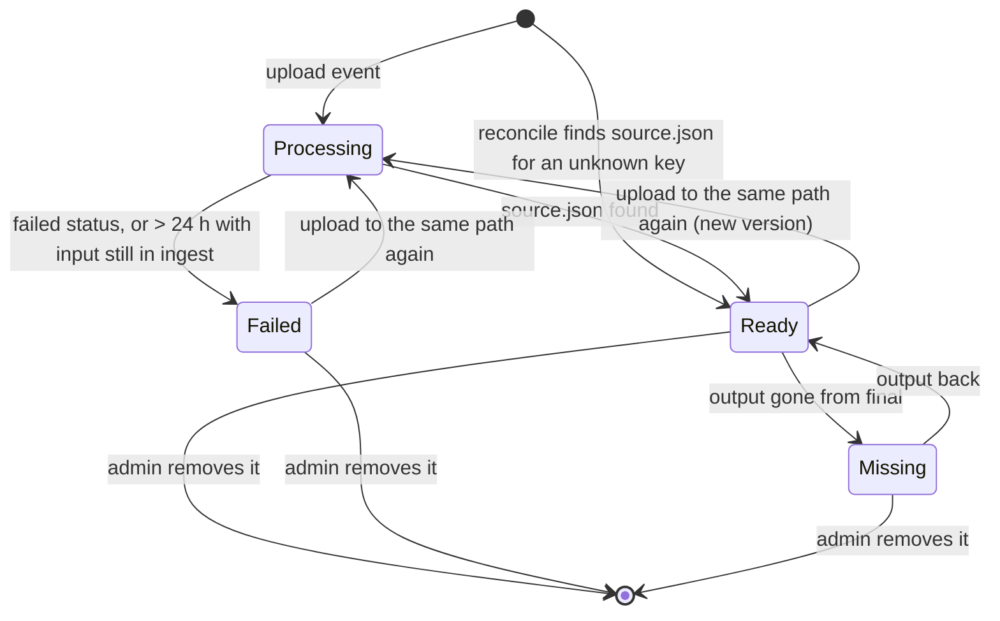
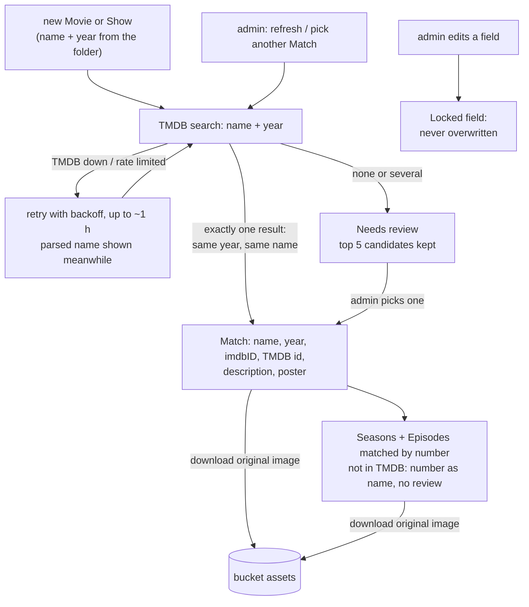
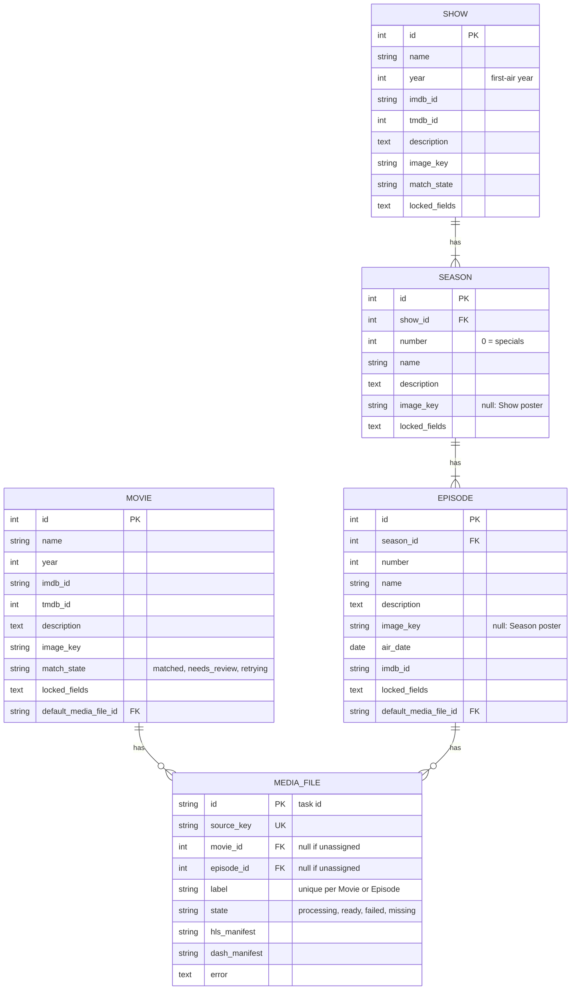

# Asset server

**Status: designed, not built yet.**

The asset server owns the **catalogue**: which Movies, Shows, Seasons and Episodes exist, their
descriptive information (name, year, imdbID, description, image) and which Media files belong to
them. It plays both the *Library service* and the *Metadata service* of the
[system architecture](architecture.md); they can be split later if enrichment needs its own scaling.

Terms are defined in `GLOSSARY.md` at the repository root; the decisions behind this page are recorded
in `docs/adr/` (ADR 0001–0004).

| | |
|---|---|
| Source | `application/asset-server/` (Rust, axum, Diesel) |
| Database | SQLite through Diesel; Postgres later (ADR 0002). Until then only **one** instance may run |
| Metadata | [TMDB](https://www.themoviedb.org), one configurable language (default `en-US`) |
| Images | bucket `assets`, original size from TMDB |
| Runs | natively, `go-task` task, like the transcoder; migrations run at startup |

## Upload layout

Where a video is uploaded in `ingest` decides what it is (ADR 0003). The year is **required**.

```
movies/<Name> (<Year>)/<label>.<ext>
shows/<Name> (<Year>)/Season <n>/S<nn>E<nn>[ anything].<ext>
shows/<Name> (<Year>)/Specials/S00E<nn>[ anything].<ext>
```

| Upload | Becomes |
|---|---|
| `movies/The Matrix (1999)/matrix.mkv` | Movie *The Matrix* (1999), Media file labelled "matrix" |
| `movies/The Matrix (1999)/matrix-directors-cut.mkv` | second Media file of the same Movie |
| `shows/Breaking Bad (2008)/Season 01/S01E02 - Cat's in the Bag.mkv` | Show *Breaking Bad* (2008), Season 1, Episode 2 |
| `shows/Breaking Bad (2008)/Specials/S00E01.mkv` | Season 0 (specials), Episode 1 |
| `movies/The Matrix/matrix.mkv` (no year), `misc/clip.mp4`, `Season 01/S02E01.mkv` | **Unassigned media file**, attached by an admin |

Nothing that is uploaded is rejected: what does not fit waits for an admin instead of being lost.

## How a Media file gets in


1. The asset server subscribes to the ingest events as its own group, so it and the transcoders each
   get every upload. From the key it computes the **same task id** as the transcoder, with the function
   from a crate both depend on.
2. It places the Media file in the catalogue from the path (or makes it an Unassigned media file),
   state **Processing**.
3. A Media file is **Ready** only when `final/<id>/source.json` exists. Status messages are
   best-effort (`try_publish`) and missed while the asset server is down, so they only trigger an early
   check; the reconcile at startup and every few minutes is what counts. `source.json` records the
   input as `{bucket, key}`, so the reconcile can also place Media files it never saw an event for.

### Media file states



- Uploading to the **same path** again is a new version of the same Media file: its Movie or Episode,
  Label and Locked fields stay.
- Only an admin removes a Media file; the asset server then deletes `final/<id>/` and the row. Output
  that disappears for any other reason makes it **Missing**, never deleted.
- A Movie or Episode without a Ready Media file is **Hidden**, not deleted, so a re-upload comes back
  with its fixes. Shows and Seasons are hidden when none of their Episodes are visible.
- One Media file per Movie or Episode is the **Default media file**. When it goes away, the oldest
  remaining Ready one takes over.
- **Labels** are unique per Movie or Episode: `matrix.mkv` and `matrix.mp4` become "matrix" and
  "matrix (mp4)". An admin can rename them.

## How imdbID, name, description and image get set



- **Automatic Match** only when exactly one TMDB result has the same year and the same name (ignoring
  case and punctuation). A wrong automatic Match is worse than one waiting for review.
- **Shows** are searched by first-air year. Their Seasons and Episodes follow by number, without a
  search or review of their own; picking another Match for the Show refills them too.
- **Fetched once**, when an entry first appears, and again only when an admin asks. No periodic
  refresh.
- **Locks are per field.** Picking another Match or refreshing refills every field that is not
  locked.
- **No image** on TMDB: none is stored. A Season falls back to its Show's poster, an Episode to its
  Season's. Placeholders are the frontend's job.

| Level | Fields from TMDB |
|---|---|
| Movie | name, year, imdbID, TMDB id, description, poster |
| Show | name, first-air year, imdbID, TMDB id, description, poster |
| Season | number, name, description, poster |
| Episode | number, name, description, still, air date, imdbID |

## Data model



A Media file belongs to a Movie **or** an Episode, or to neither while it is unassigned. Migrations
stay within SQL that SQLite and Postgres both accept (ADR 0002).

## API

**Read API** (for the frontends, through the API backend):

- Lists only entries that are not Hidden. Entries in Needs review are shown with the name and year
  from the folder, so a movie can be watched before its metadata is fixed.
- Per Media file: its Label, whether it is the default, and the **manifest keys**
  (`final/<id>/hls/master.m3u8`, `final/<id>/dash/manifest.mpd`). Delivering the streams is the
  Playback service's job.
- `GET /images/<key>` streams an image from `assets`.

**Admin API** under `/admin/...`: list Needs review and Unassigned media files, pick a Match, edit
fields (which locks them), attach an Unassigned media file, set the Default media file, rename a
Label, remove a Media file, refresh.

## Changes outside the asset server

| Where | Change |
|---|---|
| Transcoder | task id = readable prefix + 8 hex of SHA-256 over the NFC-normalised key (ADR 0004), moved into a shared crate |
| Transcoder | `source.json` stores `input` as `{"bucket": …, "key": …}` |
| `infra/init.sh` | creates the bucket `assets` |
| `final` bucket | existing outputs deleted and re-uploaded (new ids, no migration) |

## Open points

- **No authentication** on the admin API: reachable from localhost only, like the development setup
  of MQTT and RustFS. Real authentication comes with the User service.
- **One instance** while the database is SQLite.
- **Several languages** of metadata at once, **periodic refresh** (episodes described after upload),
  **image resizing** and **typed attributes** of Media files (edition, audio language) are left for
  later.
