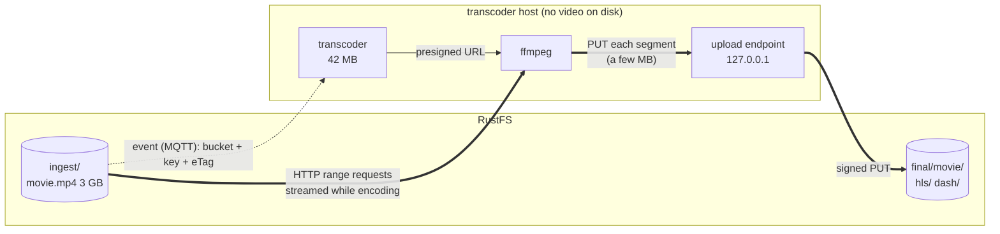

# Efficiency

> Wie könnt ihr verhindern, dass die ganzen 3 GB nicht erst ins Memory oder die Harddisk von eurem
> Transcoder geladen werden? … zeigt auf, wie ihr den Service so bauen konntet, dass er HOCH EFFIZIENT
> ist und keine unnötigen Ressourcen frisst.

Short answer: **the video is never copied to the transcoder.** ffmpeg reads it directly from the
storage over HTTP, only the parts it needs, while it needs them, and sends every finished segment
straight back. The transcoder's own disk is never touched, and its memory does not depend on the size
of the video. All numbers on this page are measured (see [How it was measured](#how-it-was-measured)).

## Results

A 3.0 GB video (5 min, 1080p, 80 Mbit/s, index at the end of the file) uploaded to `ingest`, compared
with the 21 MB `sample.mp4` (30 s). Transcoder on MQTT + RustFS, 5 renditions, HLS and DASH.

| | 21 MB video | **3 GB video** |
|---|---|---|
| Written to the transcoder's disk (transcoder + ffprobe + ffmpeg) | 0 B | **0 B** |
| Read from disk by ffmpeg | 276 KB (its own libraries) | **0 B** of video |
| Peak memory, transcoder service | 42 MB | **42 MB** |
| Peak memory, per ffmpeg run | 2.0 GB | **1.9 GB** |
| ffprobe: analyse the input | | **164 ms** (index read from the end of the file with a range request) |
| Transcode time (HLS + DASH) | 12.5 s | 176 s (3.4× real time) |
| Output uploaded to `final` | 79 MB, 100 files | 834 MB, 905 files |
| Sent by RustFS to the transcoder | | 6.0 GB = the input twice (see [What still costs](#what-still-costs)) |
| Transcoder while idle | | 0 CPU ticks in 10 s, 3 threads, 41 MB |

What the numbers show:

- **Nothing on disk.** 0 bytes written for a 3 GB input and 834 MB of output.
- **Memory does not grow with the file.** The 3 GB video needs the same memory as the 21 MB one.
  The ~2 GB of ffmpeg is the *encoder* (five x264 encoders at once, two of them 1080p, with lookahead
  and threads for 16 cores), not the video. The transcoder itself stays at ~42 MB.
- **Idle costs nothing.** Waiting for work is waiting on a socket: no polling, no CPU.

## The data path



## 1. Input: streaming instead of downloading

The transcoder never downloads the video. It signs a **presigned URL** for the object
(`storage.rs`) and gives that URL to ffprobe and ffmpeg as their input. They talk to RustFS directly:

- **Range requests.** ffmpeg's HTTP reader asks for byte ranges (`Range: bytes=…`) and only reads
  what the demuxer needs next. Data flows from the socket through ffmpeg's small read buffer into
  the decoder; nothing accumulates.
- **The index at the end is no problem.** An MP4 written without `+faststart` has its index (`moov`)
  *after* the 3 GB of media data. ffmpeg needs the index first. Over HTTP it simply asks for the last
  bytes of the file, then seeks back to the start. The test video was made this way on purpose:
  ffprobe found everything in 164 ms.
- **Why not a pipe?** Streaming the object into `ffmpeg -i pipe:0` also avoids the disk, but a pipe
  cannot seek. ffmpeg would have to read the whole file to reach the index at the end, and then
  could not go back. It works for some files and fails for others. A URL works for all of them.

| Approach | Disk | Memory | Works with index at the end |
|---|---|---|---|
| Download, then transcode | 3 GB | small | yes |
| Load into memory | 0 | 3 GB | yes |
| Pipe (`-i pipe:0`) | 0 | small | **no** (cannot seek) |
| **Presigned URL + range requests** | **0** | **small** | **yes** |

Details that make it robust:

- `-reconnect 1 -reconnect_on_network_error 1`: if the connection drops, ffmpeg continues with a
  range request where it stopped instead of failing the transcode.
- The URL is valid for 12 h, because ffmpeg uses it for every request until the end of the transcode.
- `If-Match: "<eTag>"` on every request: if the file is replaced in `ingest` during the transcode,
  RustFS answers `412` and the task fails cleanly, instead of ffmpeg mixing two versions. (Tested:
  RustFS honours `If-Match` on presigned GETs, also with ranges.)
- The URL is a secret until it expires. It is redacted in every log line (`?<signature redacted>`).

## 2. Output: streaming instead of caching

ffmpeg's HLS and DASH muxers write their files over HTTP with `-method PUT`. S3 requires every
request to be signed, which ffmpeg cannot do, so the transcoder runs a small HTTP endpoint on
`127.0.0.1` (`upload.rs`): ffmpeg PUTs each segment there, and the transcoder stores it in `final`.

- **Bounded memory.** One segment is held while it is uploaded: 4 s of video, a few MB. The reply to
  ffmpeg is only sent once the segment is stored, so ffmpeg cannot run ahead of the uploads and
  memory cannot pile up, however long the video is.
- **No disk.** There are no temporary files to write, wait for, upload and delete.
- **Available earlier.** Segments are in the bucket seconds after ffmpeg produced them, not after
  the whole transcode.
- **No half-written files.** An object in S3 only appears once its upload is complete, so nobody can
  read a partial segment or manifest.
- **Errors are not lost.** Failed uploads are counted per job; a job with one fails, even if ffmpeg
  carried on.

## 3. No unnecessary work

- **Duplicates are skipped.** A completed task leaves `final/<name>/source.json` with the input's
  eTag. Uploading the same file again costs reading that one small file instead of a full transcode:
  for the 3 GB video, a fraction of a second instead of 176 s on 16 CPU cores. Different content with the same name is transcoded
  and replaces the old result ([details](transcoder.md#duplicates-and-replacing)).
- **The input bucket does not grow.** A transcoded (or skipped) original is deleted from `ingest`,
  conditionally on its eTag, so a newer upload with the same name is never lost
  ([details](transcoder.md#duplicates-and-replacing)). `ingest` only holds what is still waiting.
- **One task per video at a time.** Two quick uploads of the same name don't transcode in parallel
  and overwrite each other; the second waits, then usually finds the first's result and skips.
- **Filtering at the source.** The bucket's event rule only fires for `.mp4`, `.mov` and `.mkv`.
  Other uploads produce no message at all, so nothing wakes up for them. The transcoder checks again
  (case-insensitive).
- **One decode for all qualities.** Each ffmpeg run decodes the input once and splits it into the
  five renditions (`split` filter), instead of decoding once per rendition.

## 4. Messaging: no polling, no buffering

- **Push instead of polling.** The mock PubSub looks into a folder every 500 ms. Over MQTT the
  transcoder waits on its connection; the broker wakes it when an event arrives. Idle cost: 0 CPU
  ticks in 10 s.
- **The broker holds the queue, not the worker.** The worker connects with **Receive Maximum =
  slots** and acknowledges a message only when its task is finished. The broker never sends more
  unfinished work than the worker has slots. Waiting events stay in the broker, where any free worker
  can get them, instead of in one busy worker's memory.
- **Scaling out** is starting another transcoder: all of them subscribe to the shared subscription
  `$share/transcoders/dodoglass/ingest`, and the broker gives each event to one of them.
- **Parse only what is needed.** An S3 event is ~2 KB of JSON, mostly request headers. serde reads
  the four fields used (bucket, key, size, eTag) and skips the rest without building it in memory.
- **Status in steps, never blocking.** Progress is published at 25 / 50 / 75 %, not on every frame.
  It never waits for the broker (`try_publish`): a slow broker cannot stall a transcode.

## 5. The service itself

- **Rust orchestrates, ffmpeg works.** The service only starts processes, moves segments and talks
  MQTT: 42 MB of memory, 3 threads when idle, a 15 MB binary.
- **async I/O (tokio).** Reading ffmpeg's output, MQTT and the uploads all run on a few threads
  without blocking each other.

## What still costs

Honest limits, measured, with what would improve them:

| Cost | Why | Improvement |
|---|---|---|
| **The input is read twice** (6.0 GB sent for a 3 GB file) and decoded twice | HLS and DASH are two ffmpeg runs | One run that writes **CMAF** (fragmented MP4) segments once, with an HLS playlist and a DASH manifest pointing at the same files (`-f dash -hls_playlist 1`). This halves reads, decoding, encoding *and* storage. Players need fMP4 HLS support (all current ones have it) |
| ~2 GB memory per ffmpeg run | Five x264 encoders with lookahead, many threads | Fewer threads per run (`-threads`), a shorter lookahead, or fewer parallel tasks (`-t`). It does not grow with file size, so it can be planned for |
| An identical file uploaded with another tool is transcoded again | The multipart eTag depends on the part size | Store a content checksum (e.g. `x-amz-checksum-sha256`) and compare that |
| Development credentials | `rustfsadmin`, anonymous MQTT | Real secrets from the environment, broker with login and TLS |

## How it was measured

On a separate, throwaway RustFS + Mosquitto stack (so no other transcoder took the job), with the
release build:

From the repository root:

```bash
# test video: 5 min 1080p, 80 Mbit/s, no +faststart (index at the end)
cd application/transcoder && ffmpeg -f lavfi -i "testsrc2=size=1920x1080:rate=24:duration=300,noise=alls=30:allf=t" \
       -f lavfi -i "sine=frequency=440:duration=300" \
       -c:v libx264 -preset ultrafast -pix_fmt yuv420p -b:v 80M -minrate 80M -maxrate 80M \
       -bufsize 80M -x264-params nal-hrd=cbr -c:a aac -shortest samples/big_3gb.mp4 && cd ../..

go-task transcoder:serve-s3 -- -t 2                     # terminal 1
application/transcoder/scripts/measure.py $(pgrep -x transcoder)   # terminal 2: memory, disk I/O
go-task infra:upload -- application/transcoder/samples/big_3gb.mp4
docker stats --no-stream infra-rustfs-1                 # network: NET I/O of the storage
```

- `scripts/measure.py` samples the transcoder and every child process (ffprobe, ffmpeg) every
  0.25 s from `/proc`: peak RSS, and `read_bytes` / `write_bytes` (what actually reached a disk).
  Network traffic is not per process in `/proc`, so it was taken from RustFS's container.
- The transcoder's own "disk read" of 27 MB is its lifetime total, mostly its binary and libraries
  being loaded at startup.
- Machine: 16 cores, 32 GB RAM, Fedora 44, ffmpeg 8.1.3, RustFS 1.0.4, everything on one host.
