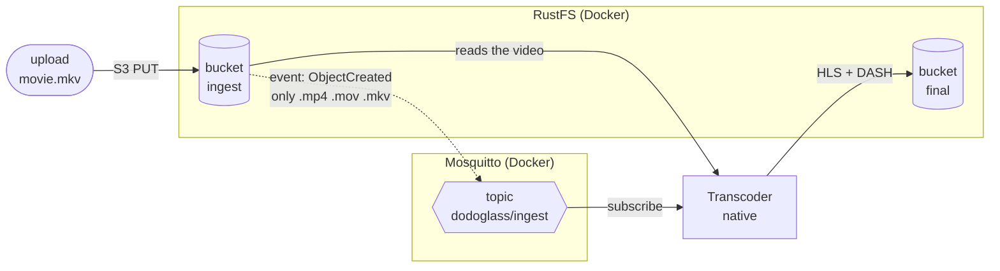

# Infrastructure

The transcoder needs two services next to it: **object storage** for the videos and an **MQTT
broker** that tells it about new ones. For development both run in Docker on the developer's machine;
the transcoder itself runs natively (`cargo run`) so code changes can be tried in seconds.

Setting it up on a new machine: see [Setup](setup.md). Files: `infra/` in the repository.

## Components

| Component | Program | Role | Port |
|---|---|---|---|
| Object storage | [RustFS](https://github.com/rustfs/rustfs) 1.0.4 | Stores the videos in buckets; S3-compatible API. Plays the **Media storage** of the [system architecture](architecture.md) | `9000` S3 API, `9001` web console |
| MQTT broker | [Eclipse Mosquitto](https://mosquitto.org) 2.1.2 | Passes messages from publishers to subscribers by topic | `1883` |
| Setup job | AWS CLI 2.39.5 | Runs once on start: creates the buckets and the event rule, then exits | – |
| Transcoder | ours, native | Subscribes to new-video events, transcodes, writes the result back | – |

### Terms

- **MQTT** is a protocol for publish/subscribe messaging. **Mosquitto** is one *broker* that
  implements it, as nginx is one server that implements HTTP. Every client (RustFS, `mosquitto_sub`,
  the transcoder) only speaks MQTT and would work with any other broker.
- **Object storage** is not a database. It stores whole files ("objects") under a key such as
  `movie.mkv`, grouped into **buckets**, and serves them over HTTP. Objects are not edited in place,
  but parts of one can be read with HTTP range requests. The S3 API, originally from Amazon, is the
  common standard; RustFS implements it, so any S3 client and library works with it.
- **Bucket notifications** are messages the storage sends when something happens in a bucket, e.g. an
  object was created. RustFS can send them directly to an MQTT broker, so no bridge program is needed.

## Data flow



1. A video is uploaded to the bucket `ingest`.
2. When the upload is **complete**, RustFS checks the bucket's event rule. If the key ends in `.mp4`,
   `.mov` or `.mkv`, it publishes an event to the MQTT topic `dodoglass/ingest`.
3. The transcoder, subscribed to that topic, receives the event, reads the video from `ingest`,
   transcodes it and writes the result to `final`.

`final` deliberately has no event rule: otherwise the transcoder's own output would trigger new jobs.

Status: steps 1 and 2 are set up and tested. Step 3 (the MQTT client in the transcoder, reading from
and writing to RustFS) is the next stage.

## Networking

```
 developer machine
 ┌──────────────────────────────────────────────────────┐
 │  docker compose (network infra_default)              │
 │  ┌───────────┐  mqtt://mosquitto:1883  ┌───────────┐ │
 │  │  rustfs   │ ──────────────────────► │ mosquitto │ │
 │  └───────────┘                         └───────────┘ │
 │     :9000 :9001                            :1883     │
 └───────▲────────────────────────────────────▲─────────┘
         │ localhost:9000                     │ localhost:1883
         └──────────── transcoder (cargo run) ┘
```

Inside a container, `localhost` is the container itself. The containers therefore reach each other by
service name (`mosquitto`, `rustfs`) on the Compose network, and the ports are published to the host
so the native transcoder can use `localhost`.

## Configuration

### `infra/compose.yml`

- **Fixed image versions** instead of `latest`, so every machine runs the same software.
- **`rustfs-data`** is a named Docker volume: bucket contents survive restarts, stay out of git, and
  there are no file permission issues with the container's user.
- **`:Z`** on the mounted config files lets the containers read them under SELinux (Fedora).
- The **`init`** service runs `infra/init.sh` and exits (see below).

### `infra/mosquitto.conf`

```conf
listener 1883
allow_anonymous true
```

Without a config file, Mosquitto 2.x only accepts connections from its own container. These lines
open it to the other containers and the host, without login. **Development only.**

### RustFS event target (environment variables)

| Variable | Value | Meaning |
|---|---|---|
| `RUSTFS_NOTIFY_ENABLE` | `true` | Turn on the notification module (off by default) |
| `RUSTFS_NOTIFY_MQTT_ENABLE_PRIMARY` | `on` | Create an MQTT target; the `_PRIMARY` suffix names it `primary` |
| `RUSTFS_NOTIFY_MQTT_BROKER_PRIMARY` | `mqtt://mosquitto:1883` | The broker, by its Compose service name |
| `RUSTFS_NOTIFY_MQTT_TOPIC_PRIMARY` | `dodoglass/ingest` | Topic the events are published to |
| `RUSTFS_NOTIFY_MQTT_QOS_PRIMARY` | `1` | *At least once*: the broker acknowledges each message. With QoS 0 an event can be lost silently |

The target's ID, needed by the event rule, is the ARN `arn:rustfs:sqs:us-east-1:primary:mqtt`
(format `arn:rustfs:sqs:<region>:<target name>:<type>`). The RustFS docs only name two of the MQTT
variables; the full list is in the RustFS source, `crates/config/src/notify/mqtt.rs`.

### Event rule: `infra/ingest-notification.json`

Three rules on the bucket `ingest`, one per file type, because a rule can have only one suffix
filter:

```json
{
  "Id": "ingest-mkv",
  "QueueArn": "arn:rustfs:sqs:us-east-1:primary:mqtt",
  "Events": ["s3:ObjectCreated:*"],
  "Filter": { "Key": { "FilterRules": [{ "Name": "suffix", "Value": ".mkv" }] } }
}
```

Suffix matching is **case-sensitive**: `MOVIE.MKV` does not trigger an event. The transcoder should
check the file type itself as well.

### Setup as code: `infra/init.sh`

The buckets and the event rule live inside RustFS's data volume, not in git. Clicking them together
in the web console works once, but cannot be reviewed or repeated on another machine. `init.sh` does
it on every `docker compose up` instead:

1. wait until RustFS answers,
2. create `ingest` and `final` unless they exist,
3. set the event rule from `ingest-notification.json`. This *replaces* the bucket's whole
   notification config, so the file is the single source of truth.

It is **idempotent**: running it again changes nothing. Tested on an existing setup and on an empty
RustFS volume.

## The event message

What RustFS publishes for an upload of `sample.mp4` through the web console (shortened):

```json
{
  "EventName": "s3:ObjectCreated:CompleteMultipartUpload",
  "Key": "ingest/sample.mp4",
  "Records": [{
    "object_name": "sample.mp4",
    "bucket_name": "ingest",
    "data": {
      "eventVersion": "2.1",
      "eventSource": "rustfs:s3",
      "eventTime": "2026-11-09T18:22:46.253Z",
      "eventName": "s3:ObjectCreated:CompleteMultipartUpload",
      "s3": {
        "bucket": { "name": "ingest", "arn": "arn:aws:s3:::ingest" },
        "object": {
          "key": "sample.mp4",
          "size": 20966549,
          "eTag": "748965504cce42abd1c302a2971f98c7-2",
          "contentType": "video/mp4"
        }
      }
    }
  }]
}
```

RustFS wraps the **standard S3 event format** (`Records[].data`, the same as Amazon S3 and MinIO)
in an envelope of its own (`EventName`, `Key`, `object_name`, `bucket_name`).

Findings:

| Observation | Consequence for the transcoder |
|---|---|
| `data.s3.bucket.name` + `data.s3.object.key` identify the video | Read those from the standard part, not the RustFS envelope, so the code also works with other S3 storage |
| `Records` is a list | One message can carry several events; handle every entry |
| The key is URL-encoded in the S3 format (`my movie.mp4` → `my+movie.mp4`) | Decode it before use |
| `CompleteMultipartUpload`, eTag ending in `-2`: the browser uploaded in 2 parts | The event only comes once the **whole** upload is done, so a half-uploaded file is never transcoded. Large files are always uploaded in parts |
| `size` is included | Known before reading a byte, e.g. for logging or limits |
| No task id, no formats | Derive the id from the key; use the service's default formats |
| `requestParameters` contains request headers, with secrets redacted | Not needed; don't log it in full |

## Open points

- **One task, one worker.** MQTT delivers a message to *every* subscriber of a topic. With two
  transcoders running, both would transcode the same video. Solution for the next stage: a shared
  subscription (`$share/<group>/dodoglass/ingest`), where the broker gives each message to only one
  member of the group.
- **Credentials.** `rustfsadmin`/`rustfsadmin` are RustFS's public defaults, and Mosquitto allows
  anonymous clients. Fine on a developer machine; a real deployment would use secrets from the
  environment and a broker with login and TLS.
- **Lost events.** If the broker is down when a video is uploaded, the event can be lost. RustFS can
  buffer events on disk (`RUSTFS_NOTIFY_MQTT_QUEUE_DIR_PRIMARY`); not configured yet.
