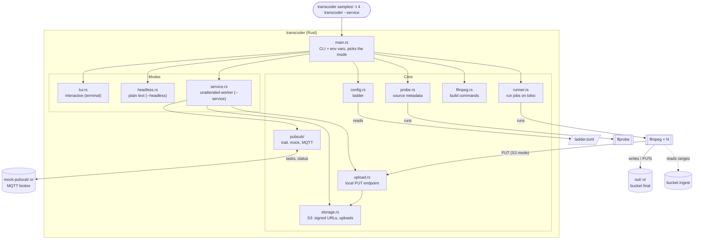
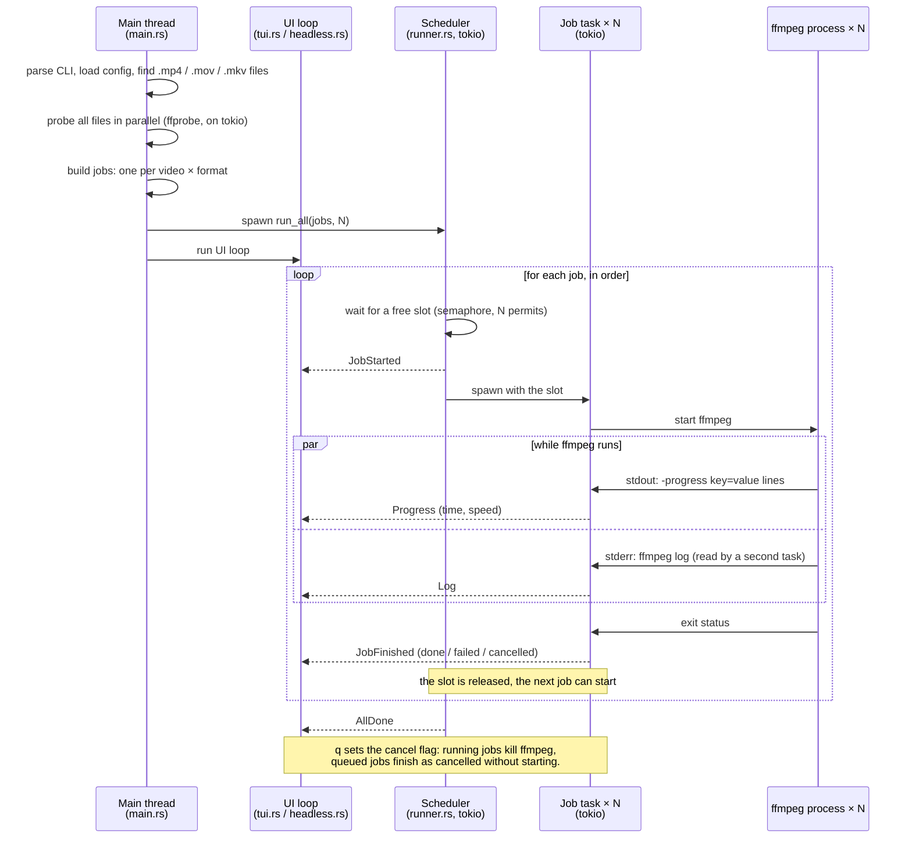
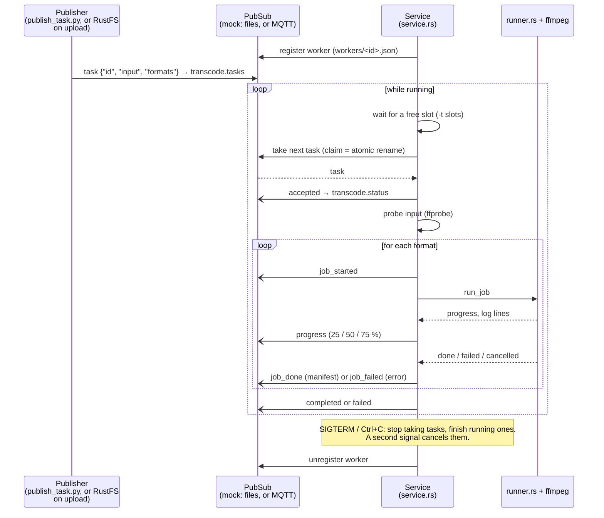
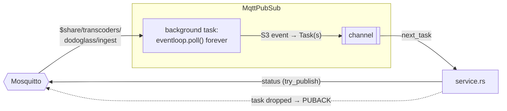
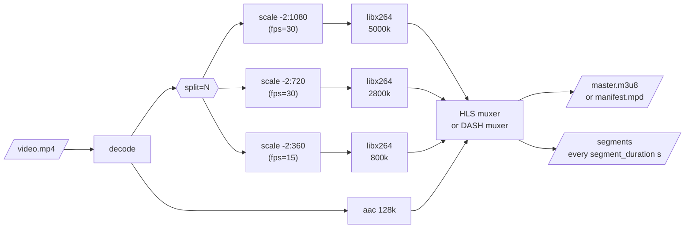

# Transcoder

The transcoder is a Rust command-line program that wraps **ffmpeg**. It takes a video file, or a
folder of `.mp4`, `.mov` and `.mkv` files, plus a transcoding config, and produces **HLS** and **DASH** output with
several quality levels ("renditions") in one manifest each. Several videos are transcoded in
parallel. It is the Transcoder of the [system architecture](architecture.md).

It runs in three modes:

- **Interactive** (TUI): `transcoder samples/`, with a full-screen progress view.
- **Headless**: the same, with plain text output for scripts.
- **Service**: `transcoder --service`, an unattended worker that takes tasks from PubSub and
  publishes status. This is how it runs on the platform, later as a Docker container. With
  `--pubsub mqtt` and `--output-bucket` it reacts to uploads in the `ingest` bucket and writes the
  result to the `final` bucket, without ever storing the video on its own disk (see
  [Efficiency](efficiency.md)).

Source: `application/transcoder/`. Usage is described in its `README.md`.

## Structure

`main.rs` reads the command-line arguments and wires the modules together. Each module has one job;
the external programs (ffprobe, ffmpeg) do the actual media work.



| Module | Responsibility |
|---|---|
| `main.rs` | Parses CLI arguments and environment variables (clap), picks the mode; in interactive and headless mode finds and probes the input files and builds the jobs |
| `config.rs` | Loads `ladder.toml` (or the built-in copy) and validates it |
| `probe.rs` | Runs `ffprobe` and extracts duration, resolution, frame rate and whether there is audio |
| `ffmpeg.rs` | Data model (`Video`, `Job`, `Format`) and turning config + source info into ffmpeg arguments |
| `runner.rs` | Runs ffmpeg jobs on tokio and reports progress as events; `run_all` for a batch, `run_job` for one job |
| `tui.rs` | Full-screen interface (ratatui): overall progress, one row per video, ladder, speed graph, log |
| `headless.rs` | Plain text progress for scripts and CI |
| `service.rs` | Service mode: registers on PubSub, takes tasks, runs them, publishes status, shuts down gracefully |
| `pubsub/mod.rs` | The `PubSub` and `Publisher` traits, the message types (`Task`, `Input`, `StatusMessage`, `WorkerInfo`) and `Ack` (acknowledge a message when its task is dropped) |
| `pubsub/mock.rs` | A file-based PubSub for development |
| `pubsub/mqtt.rs` | PubSub over MQTT 5: shared subscription to the bucket events, status and worker registration as topics |
| `pubsub/s3_event.rs` | Turns an S3 bucket notification (as RustFS sends it) into bucket + key + eTag |
| `storage.rs` | S3 access (`object_store`): presigned read URLs, uploads, deleting old output |
| `upload.rs` | HTTP endpoint on 127.0.0.1 that ffmpeg PUTs its output to; each file is passed on to the bucket |

### Data model

| Type | What it is |
|---|---|
| `Video` | One input: what ffmpeg opens (a path, or a presigned URL plus the eTag to pin), name, output (`OutDir`), and the ffprobe result (or why probing failed) |
| `OutDir` | Where a job writes: a folder on disk, or an HTTP upload target (`url` for ffmpeg, `shown` = `s3://…` for logs) |
| `Job` | One ffmpeg run: **one video in one format**. A folder of 6 videos in HLS + DASH is 12 jobs |
| `Task` / `Input` | Service mode: one unit of work from PubSub; its input is a file or a bucket object (bucket, key, eTag). Carries the `Ack` that confirms the message when the task is dropped |
| `Event` | A message from the runner to the UI (see below) |
| `Outcome` | How a job ended: done, failed (with the reason) or cancelled |

## Runtime (interactive and headless)

The jobs run on a **tokio** runtime with N worker threads (`--threads`, default 4). Each job is a
tokio task that starts one ffmpeg process and reads its output asynchronously. A **semaphore** with N
permits limits how many run at once: the scheduler takes a permit before starting a job, so jobs start
in list order and at most N ffmpeg processes exist at any time. When a job finishes, its permit is
released and the next job starts.

The UI runs on the main thread, outside tokio. Tasks report back through one channel; the UI only
ever receives events and draws them. Both front ends (TUI and headless) consume the same events, so
the transcoding logic does not know or care which one is active.



| Event | Sent when | Carries |
|---|---|---|
| `JobStarted` | a job got a slot and is about to start ffmpeg | job index |
| `Progress` | ffmpeg finishes a `-progress` block (about twice a second) | encoded time, speed |
| `Log` | ffmpeg writes a line to stderr | job index, the line |
| `JobFinished` | ffmpeg exits, or a queued job is skipped after a cancel | job index, `Outcome` |
| `AllDone` | every job has finished | nothing |

Progress comes from ffmpeg's `-progress pipe:1` option, which writes machine-readable `key=value` lines
to stdout. A job's percentage is `out_time_us` divided by the video's duration from ffprobe; the
overall percentage is the average over all jobs.

### Failure and cancellation

- A file ffprobe cannot read is reported and skipped; the other videos still run. For a single-file
  input this is an error instead.
- A failing job does not stop the others.
- Cancelling (`q` in the TUI) sets a shared flag. Running jobs see it on their next progress line and
  kill their ffmpeg; queued jobs are marked cancelled without starting.
- The exit code is non-zero if any video was unreadable, or any job failed or was cancelled.

### CPU usage

Each ffmpeg process already uses every CPU core for encoding, so N parallel jobs share the CPU rather
than each getting their own. More parallel jobs mainly help when single jobs cannot keep all cores
busy (short videos, the decoding and muxing steps). Watch the total speed graph in the TUI to find a
good value for a given machine.

## Service mode

`transcoder --service` turns the program into an unattended worker. It has no TUI and no input
argument: tasks arrive over PubSub, status goes back over PubSub, and logs go to stdout.



### Channels and messages

| Channel (mock) | Topic (MQTT) | Direction | Content |
|---|---|---|---|
| `transcode.tasks` | `$share/transcoders/dodoglass/ingest` | storage / platform → worker | one task per message; each task goes to exactly one worker |
| `transcode.status` | `dodoglass/status` | worker → platform | status messages for every task |
| `workers/<id>.json` | `dodoglass/workers/<id>` (retained) | worker → platform | registration; removed on exit (MQTT: by the broker's last will on a crash) |

A **task** (JSON, mock):

```json
{"id": "holiday-2024", "input": "/data/in/holiday.mp4", "formats": ["hls", "dash"]}
{"id": "holiday-2024", "input": {"bucket": "ingest", "key": "holiday.mp4", "etag": "…"}}
```

| Field | Required | Meaning |
|---|---|---|
| `id` | no (mock: file name) | unique task name; also the output folder `<out>/<id>`. Letters, digits, `-`, `_`, `.` |
| `input` | yes | the video: a path **the service** can read (in a container: a mounted path), or an object in a bucket. Must end in `.mp4`, `.mov` or `.mkv` (any case) |
| `formats` | no | `hls`, `dash` or both; default: the service's `--format` |

Over MQTT the task is not sent in this form: it is made from the **S3 event** RustFS publishes when
an upload completes (see [Infrastructure](infrastructure.md#the-event-message)). The id comes from
the key: `shows/Episode 1.mkv` → `shows_Episode_1`.

A **status message** (one per event):

```json
{"time_ms": 1793128170038, "worker": "worker-1", "task": "holiday-2024", "event": "job_done",
 "format": "HLS", "manifest": "/data/out/holiday-2024/hls/master.m3u8"}
```

| `event` | Sent when | Extra fields |
|---|---|---|
| `accepted` | the worker took the task | |
| `rejected` | the message was not a valid task | `error` |
| `job_started` | a format starts | `format` |
| `progress` | a format passes 25 / 50 / 75 % | `format`, `percent` |
| `job_done` | a format finished | `format`, `manifest` |
| `job_failed` | a format failed | `format`, `error` |
| `completed` | every format of the task succeeded | |
| `skipped` | the same version of this video was already transcoded (see [Duplicates](#duplicates-and-replacing)) | |
| `failed` | the task did not complete (unreadable input, failed or cancelled job) | `error`, maybe `format` |

### Slots and scheduling

`--threads` sets how many **tasks** a worker runs at the same time. A task holds one slot from start to
end and runs its formats one after another. The worker only takes a task from the channel when a slot
is free, so tasks it cannot start yet stay available for other workers. Scaling out means starting
more workers.

With MQTT the broker *pushes* messages, so "only take a task when a slot is free" has to be told to
the broker: the worker connects with **Receive Maximum = slots** and acknowledges a message only when
its task is **finished**. The broker never has more unacknowledged messages out to a worker than it
has slots; the rest wait in the broker, not in the worker's memory. See [MQTT backend](#the-mqtt-backend)
(including what has not been tested with several workers).

### The mock PubSub

`--pubsub mock` (the default) uses a folder (`--mock-dir`, default `mock-pubsub/`):

```
mock-pubsub/
├── transcode.tasks/          ← a <name>.json here is a published task
│   ├── claimed/              ← tasks a worker took: <name>.json.<worker>
│   └── rejected/             ← messages that were not valid tasks
├── transcode.status.jsonl    ← status messages, one JSON object per line
└── workers/<worker>.json     ← registered workers
```

A worker claims a task by **renaming** its file into `claimed/`. Renaming is atomic, so when several
workers poll the same folder only one of them gets each task, the same guarantee a real queue gives.
`scripts/publish_task.py` publishes tasks (writing to a temporary name first so a worker never reads
a half-written file) and can follow their status.

The service only talks to the `PubSub` and `Publisher` traits. The MQTT backend implements the same
two traits; `service.rs` did not change for it.

### The MQTT backend

`--pubsub mqtt` (`pubsub/mqtt.rs`, client library `rumqttc`, MQTT 5):



- **The event loop runs in its own task.** rumqttc must be polled constantly: it sends the keep-alive
  pings, receives messages and sends what the client handles queued. If it were only polled in
  `next_task`, a worker busy for minutes would miss its pings and be disconnected.
- **Shared subscription** `$share/<group>/<topic>`: the broker gives each event to one worker of the
  group, so several transcoders split the work instead of all doing the same video.
- **Acknowledge when done.** `manual_acks`, and every task carries an `Ack` handle; when the last copy
  of the task is dropped (done, failed, skipped, early return) the message is acknowledged, exactly
  once. One S3 message can hold several records; it is acknowledged when all of its tasks are done.
  Messages that are not valid tasks are acknowledged right away (redelivering them would not help).
- **Reconnects:** on a new connection the worker subscribes again and republishes its registration.
  Packet ids start over with every connection, so an acknowledgement for a message from an earlier
  connection is *not* sent: it could hit a different message.
- **Status never blocks:** status is published with `try_publish`. If the broker is unreachable and
  rumqttc's queue (64 requests) is full, a status update is dropped and logged, instead of stalling
  the task that reports it and the ffmpeg process it reads from.
- **Registration:** retained on `dodoglass/workers/<id>`; cleared on exit, and by the broker's
  *last will* if the worker dies without exiting cleanly.
- The first connection is awaited at startup (10 s), so a wrong broker address fails immediately.

**Tested** with one worker: events in, tasks run, status and registration out, acknowledgement after
the task, reconnect handling compiled but not provoked. **Not tested yet:**

- **Two or more workers.** By the MQTT 5 spec, the shared subscription gives each event to one
  member, and Receive Maximum stops the broker from sending a worker more unfinished messages than it
  has slots. *Which* member gets an event is the broker's choice: Mosquitto picks members in turn, so
  an event may wait for a busy worker while another one is idle. Start two `serve-s3` in two
  terminals and upload several videos to see it.
- **A worker that crashes mid-task.** Its message was never acknowledged. Whether the broker hands
  it to another member, or keeps it for a client with that id that never comes back (the id contains
  the process id), depends on the broker and the session settings; with `clean_start` the session
  ends with the connection.

### Known issue

Once, during development, the input `ingest/sample.mp4` disappeared while a second upload of the
same file was being transcoded: the DASH job got `404 Not Found` and the bucket was empty afterwards.
It could not be reproduced: uploading twice, deleting old output, and the whole pipeline twice in a
row on a fresh RustFS all left the input in place, and ffmpeg sent no DELETE. Since then, inputs are
read with `If-Match`, so a vanished or replaced input fails cleanly (`404` / `412`) rather than
silently. If it happens again, `RUST_LOG=info,transcoder::upload=debug` logs every upload and delete
of the service.

### Inputs and outputs in buckets

With `--s3-endpoint` (and keys), inputs can be objects; with `--output-bucket` results are written
to that bucket instead of `--out`. How this avoids the disk entirely is explained in
[Efficiency](efficiency.md); in short:

- **Input:** the service creates a **presigned URL** for the object (valid 12 h, because ffmpeg uses
  it for the whole transcode) and gives that to ffprobe and ffmpeg. They read the video straight from
  the storage with HTTP range requests, and reconnect and continue where they were if the connection
  drops (`-reconnect`). With the eTag from the event they send `If-Match`, so a file replaced during
  the transcode fails with `412` instead of mixing two versions.
- **Output:** ffmpeg uploads every segment, playlist and manifest with HTTP `PUT` (`-method PUT`) to a
  small endpoint of the service on `127.0.0.1` (`upload.rs`), which stores each file in the bucket,
  signed, before answering ffmpeg. A random token in the path keeps other local programs out.
  Upload errors are counted per job; a job with a failed upload fails, even if ffmpeg did not stop.
- **Old output** in the bucket (`<id>/hls/`, `<id>/dash/`) is deleted before each format starts, as
  the runner does for folders on disk.
- **Object keys are used unchanged**, including spaces, brackets and other special characters
  (`[Judas] Kusuriya - S03E06.mkv`). `object_store`'s usual `Path::from` would percent-encode
  `[ ] { } # ~ …` into the path, and the request URL encodes it again: `[` became `%255B` and RustFS
  answered 404. `storage.rs` uses `Path::parse`, which keeps the key; tested against RustFS with
  such keys (upload, presigned read, conditional delete).
- **Signed URLs are secrets** until they expire: the command line and every ffmpeg log line pass
  through `redact()`, which replaces `?X-Amz-…` with `?<signature redacted>`.

### Duplicates and replacing

The task id comes from the object's name, so the **name is the identity of a video**: uploading
`sample.mp4` again means "new version of `sample`", and its result in `final/sample/` is replaced.

| Upload | Result |
|---|---|
| a name not seen before | transcoded |
| the same name, **same content** (same eTag) | `skipped`: no work at all |
| the same name, different content | transcoded, the old result replaced |
| the same name while it is being transcoded | waits for the running task, then one of the above |

- After a task completed, `final/<id>/source.json` records the input, its **eTag** and the formats.
  An event with the same eTag and formats is skipped. The marker is deleted before a replacement
  starts, so a half-replaced output is never taken for complete.
- **At most one task per id at a time:** a second one waits (keeping its slot) instead of running in
  parallel and deleting the other's files.
- **eTag caveat:** for multipart uploads the eTag depends on the part size (`…-2` = two parts). The
  same file uploaded with a different tool (browser: 2 parts, AWS CLI: 8 MB parts) gets a different
  eTag and is transcoded again. This errs on the safe side: different content never has the same eTag.
- **The input is consumed.** After a task completed *or* was skipped, the original is deleted from
  `ingest`, so the bucket only holds videos that are still waiting (or failed: a failed task keeps
  its input for a retry). The delete is conditional, `DELETE` with `If-Match: "<eTag>"`: if a newer
  upload with the same name arrived during the transcode, *that* file is kept for its own task
  instead of being deleted unseen. `object_store` has no conditional delete, so `storage.rs` signs a
  DELETE URL with it and sends the request with the header itself. `--keep-input` turns the deleting
  off. Files on disk (mock tasks) are never deleted.
- Two *different* videos with the same name overwrite each other's result. A production system would
  give each version its own folder (`final/<id>/<eTag>/…` plus a `latest.json` pointing at the current
  one), so nothing a player might be reading is ever overwritten. Not needed here.

### Logging

Logs are one line per event on stdout via `tracing`: human-readable text by default,
`--log-format json` for log collectors. Every line of a task carries its id. The level comes from
`RUST_LOG` (default `info`); ffmpeg's own output is only logged at `debug`, except that the last
lines of ffmpeg's output are included when a job fails, since they usually say why.

```text
INFO task{id=holiday-2024}: input probed width=1920 height=1080 fps="24.000" duration_s="20.0" audio=true
INFO task{id=holiday-2024}: progress format="HLS" percent="51" speed="10.20x"
INFO task{id=holiday-2024}: job done format="HLS" took_s="2.1" manifest=/data/out/holiday-2024/hls/master.m3u8
```

### Shutdown

| Signal | Effect |
|---|---|
| first SIGTERM or Ctrl+C | stop taking tasks, let running tasks finish, unregister, exit |
| second SIGTERM or Ctrl+C | cancel running tasks (ffmpeg is killed, tasks report `failed: cancelled`), exit |

In service mode ffmpeg runs in its own process group, so a Ctrl+C in the terminal reaches only the
service and not ffmpeg directly; otherwise the first Ctrl+C would kill running transcodes.

### Running in a container

The service is built to run as a Docker container:

- **Configuration through environment variables:** every option has one (table below), so a
  container is configured without changing its command.
- **Logs on stdout**, with JSON available, for `docker logs` and log collectors.
- **SIGTERM** (what `docker stop` sends) shuts down gracefully. Docker waits 10 s by default before
  killing; transcodes take longer, so give the container a longer stop timeout
  (`docker stop -t`, Compose `stop_grace_period`).
- **No terminal needed.**
- **Worker id** defaults to `<hostname>-<pid>`; in a container the hostname is the container ID.
- **Paths** in tasks are paths inside the container: mount the input and output folders
  (e.g. `/data/in`, `/data/out`) and point `TRANSCODER_OUT` at the output mount.
- **With buckets no mount is needed at all**: inputs are read from S3 and outputs uploaded to it.
  `TRANSCODER_S3_ENDPOINT` must be an address the *container* can reach (in Compose:
  `http://rustfs:9000`, not `localhost`), because the presigned URLs ffmpeg uses point at it. The
  upload endpoint on `127.0.0.1` is inside the container, next to ffmpeg, and needs no port.

| Option | Environment variable | Default |
|---|---|---|
| `--service` | `TRANSCODER_SERVICE=true` | off |
| `--pubsub` | `TRANSCODER_PUBSUB` | `mock` (or `mqtt`) |
| `--mock-dir` | `TRANSCODER_MOCK_DIR` | `mock-pubsub` |
| `--mqtt-url` | `TRANSCODER_MQTT_URL` | `mqtt://localhost:1883` |
| `--mqtt-topic` | `TRANSCODER_MQTT_TOPIC` | `dodoglass/ingest` |
| `--mqtt-group` | `TRANSCODER_MQTT_GROUP` | `transcoders` |
| `--mqtt-status-topic` | `TRANSCODER_MQTT_STATUS_TOPIC` | `dodoglass/status` |
| `--mqtt-workers-topic` | `TRANSCODER_MQTT_WORKERS_TOPIC` | `dodoglass/workers` |
| `--s3-endpoint` | `TRANSCODER_S3_ENDPOINT` | none (no S3) |
| `--s3-access-key` | `TRANSCODER_S3_ACCESS_KEY` | |
| `--s3-secret-key` | `TRANSCODER_S3_SECRET_KEY` (prefer this: arguments show in `ps`) | |
| `--s3-region` | `TRANSCODER_S3_REGION` | `us-east-1` |
| `--output-bucket` | `TRANSCODER_OUTPUT_BUCKET` | none (write to `--out`) |
| `--keep-input` | `TRANSCODER_KEEP_INPUT=true` | off: inputs in a bucket are deleted after a completed or skipped task |
| `--worker-id` | `TRANSCODER_WORKER_ID` | `<hostname>-<pid>` |
| `--threads` | `TRANSCODER_THREADS` | `4` |
| `--out` | `TRANSCODER_OUT` | `out` |
| `--format` | `TRANSCODER_FORMAT` | `both` |
| `--config` | `TRANSCODER_CONFIG` | built-in ladder |
| `--log-format` | `TRANSCODER_LOG_FORMAT` | `text` |
| log level | `RUST_LOG` | `info` |

## The ffmpeg pipeline

Each job is **one** ffmpeg run that decodes the input once and encodes every rendition from it.
HLS and DASH are separate jobs with the same encoding settings and a different output muxer.



How the config maps onto ffmpeg options:

| Config | ffmpeg | Why |
|---|---|---|
| one `[[rendition]]` per version | `split=N`, one `scale=-2:<height>` and one `-map` each | decode once, scale per rendition |
| `height` | `scale=-2:<height>` | width follows the source's aspect ratio, rounded to an even number |
| `fps` (global or per rendition) | `,fps=<fps>` after the scale | change the frame rate; without it the source's is kept |
| `bitrate_kbps`, `maxrate_kbps`, `bufsize_kbps` | `-b:v:N`, `-maxrate:v:N`, `-bufsize:v:N` | average bitrate plus a cap on peaks |
| `segment_duration` | `-force_key_frames expr:gte(t,n_forced*S)`, `-sc_threshold 0`, `-hls_time S` / `-seg_duration S` | a keyframe at every segment boundary in every rendition, so segments line up and players can switch quality |
| `preset` | `-preset` | x264 speed vs. compression |
| `audio_bitrate_kbps` | `-c:a aac -ac 2 -b:a` | stereo AAC (left out if the source has no audio) |

Keyframes are forced by **time**, not by frame count, so renditions with different frame rates still
get segment boundaries at exactly the same moments.

Differences between the two formats:

| | HLS | DASH |
|---|---|---|
| Manifest | `master.m3u8` plus one `index.m3u8` per rendition | one `manifest.mpd` |
| Audio | mapped once per rendition (`-var_stream_map v:N,a:N`) | mapped once, shared (`-adaptation_sets`) |
| Segments | MPEG-TS (`.ts`) | fragmented MP4 (`.m4s`) |

DASH requires every rendition in an adaptation set to have exactly the same aspect ratio. Rounded
widths (480p is 854 wide, not 853.3) are compensated by a slightly non-square pixel shape, which is
why the scale filter must not be followed by `setsar=1`.

Heights are applied literally, also for portrait video: the "1080p" rendition of a 1080×1920 phone
video is 608×1080.

## Output layout

```
out/
└── <video name>/
    ├── hls/
    │   ├── master.m3u8          ← player opens this
    │   ├── 1080p/
    │   │   ├── index.m3u8
    │   │   └── seg_000.ts …
    │   └── 720p/ …
    └── dash/
        ├── manifest.mpd         ← player opens this
        ├── init-stream0.m4s …   ← one per rendition + audio
        └── chunk-stream0-00001.m4s …
```

With `--output-bucket` the same layout is in the bucket, plus the marker of the version it was made
from:

```
s3://final/<task id>/
├── hls/ …                   ← as above
├── dash/ …
└── source.json              ← {"input", "etag", "formats", "completed_ms", "worker"}
```

Every job deletes and recreates its own `hls/` or `dash/` folder (in a bucket: the objects below
that prefix), so segments from an earlier run with a different ladder never mix in. Two input files whose names differ only in case (`a.mp4`, `a.MP4`)
would share an output folder and are rejected.
