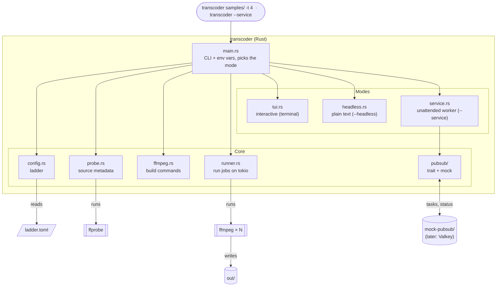
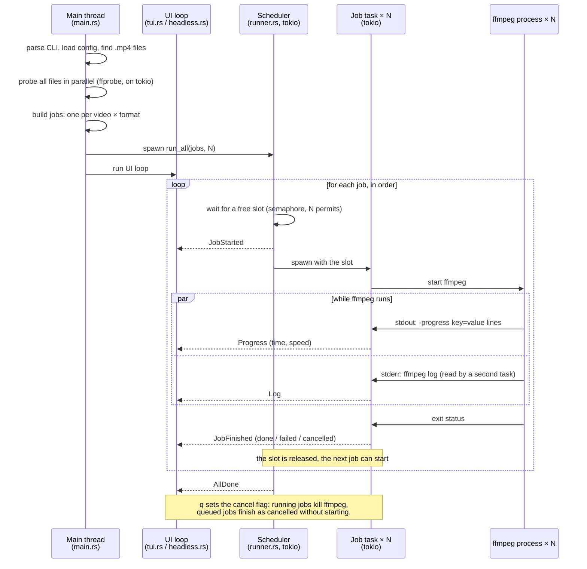
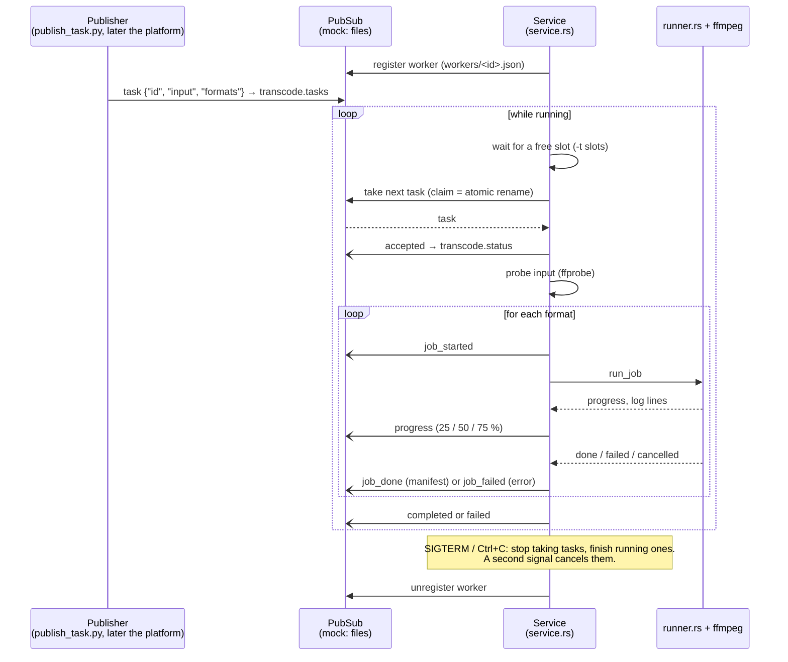
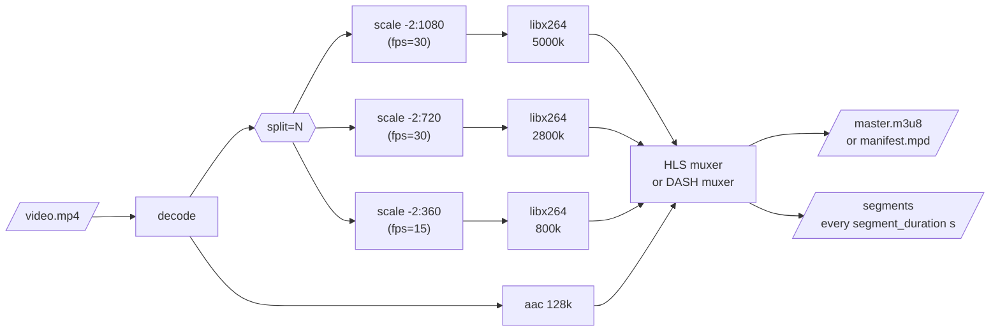

# Transcoder

The transcoder is a Rust command-line program that wraps **ffmpeg**. It takes a video file, or a
folder of `.mp4` files, plus a transcoding config, and produces **HLS** and **DASH** output with
several quality levels ("renditions") in one manifest each. Several videos are transcoded in
parallel. It is the Transcoder of the [system architecture](architecture.md).

It runs in three modes:

- **Interactive** (TUI): `transcoder samples/`, with a full-screen progress view.
- **Headless**: the same, with plain text output for scripts.
- **Service**: `transcoder --service`, an unattended worker that takes tasks from PubSub and
  publishes status. This is how it runs on the platform, later as a Docker container.

Source: `application/transcoder/`. Usage is described in its `README.md`.

## Structure

`main.rs` reads the command-line arguments and wires the modules together. Each module has one job;
the external programs (ffprobe, ffmpeg) do the actual media work.



| Module | Responsibility |
|---|---|
| `main.rs` | Parses CLI arguments and environment variables (clap), picks the mode; in interactive and headless mode finds and probes the input files and builds the jobs |
| `config.rs` | Loads `ladder.toml` (or the built-in copy) and validates it |
| `probe.rs` | Runs `ffprobe` and extracts duration, resolution, frame rate and whether there is audio |
| `ffmpeg.rs` | Data model (`Video`, `Job`, `Format`) and turning config + source info into ffmpeg arguments |
| `runner.rs` | Runs ffmpeg jobs on tokio and reports progress as events; `run_all` for a batch, `run_job` for one job |
| `tui.rs` | Full-screen interface (ratatui): overall progress, one row per video, ladder, speed graph, log |
| `headless.rs` | Plain text progress for scripts and CI |
| `service.rs` | Service mode: registers on PubSub, takes tasks, runs them, publishes status, shuts down gracefully |
| `pubsub/mod.rs` | The `PubSub` and `Publisher` traits, and the message types (`Task`, `StatusMessage`, `WorkerInfo`) |
| `pubsub/mock.rs` | A file-based PubSub for development; Valkey will be a second implementation of the same trait |

### Data model

| Type | What it is |
|---|---|
| `Video` | One input file: path, name, output folder, and the ffprobe result (or why probing failed) |
| `Job` | One ffmpeg run: **one video in one format**. A folder of 6 videos in HLS + DASH is 12 jobs |
| `Event` | A message from the runner to the UI (see below) |
| `Outcome` | How a job ended: done, failed (with the reason) or cancelled |

## Runtime (interactive and headless)

The jobs run on a **tokio** runtime with N worker threads (`--threads`, default 4). Each job is a
tokio task that starts one ffmpeg process and reads its output asynchronously. A **semaphore** with N
permits limits how many run at once: the scheduler takes a permit before starting a job, so jobs start
in list order and at most N ffmpeg processes exist at any time. When a job finishes, its permit is
released and the next job starts.

The UI runs on the main thread, outside tokio. Tasks report back through one channel; the UI only
ever receives events and draws them. Both front ends (TUI and headless) consume the same events, so
the transcoding logic does not know or care which one is active.



| Event | Sent when | Carries |
|---|---|---|
| `JobStarted` | a job got a slot and is about to start ffmpeg | job index |
| `Progress` | ffmpeg finishes a `-progress` block (about twice a second) | encoded time, speed |
| `Log` | ffmpeg writes a line to stderr | job index, the line |
| `JobFinished` | ffmpeg exits, or a queued job is skipped after a cancel | job index, `Outcome` |
| `AllDone` | every job has finished | nothing |

Progress comes from ffmpeg's `-progress pipe:1` option, which writes machine-readable `key=value` lines
to stdout. A job's percentage is `out_time_us` divided by the video's duration from ffprobe; the
overall percentage is the average over all jobs.

### Failure and cancellation

- A file ffprobe cannot read is reported and skipped; the other videos still run. For a single-file
  input this is an error instead.
- A failing job does not stop the others.
- Cancelling (`q` in the TUI) sets a shared flag. Running jobs see it on their next progress line and
  kill their ffmpeg; queued jobs are marked cancelled without starting.
- The exit code is non-zero if any video was unreadable, or any job failed or was cancelled.

### CPU usage

Each ffmpeg process already uses every CPU core for encoding, so N parallel jobs share the CPU rather
than each getting their own. More parallel jobs mainly help when single jobs cannot keep all cores
busy (short videos, the decoding and muxing steps). Watch the total speed graph in the TUI to find a
good value for a given machine.

## Service mode

`transcoder --service` turns the program into an unattended worker. It has no TUI and no input
argument: tasks arrive over PubSub, status goes back over PubSub, and logs go to stdout.



### Channels and messages

| Channel | Direction | Content |
|---|---|---|
| `transcode.tasks` | platform → worker | one task per message; each task goes to exactly one worker |
| `transcode.status` | worker → platform | status messages for every task |

A **task** (JSON):

```json
{"id": "holiday-2024", "input": "/data/in/holiday.mp4", "formats": ["hls", "dash"]}
```

| Field | Required | Meaning |
|---|---|---|
| `id` | no (mock: file name) | unique task name; also the output folder `<out>/<id>`. Letters, digits, `-`, `_`, `.` |
| `input` | yes | the video, as a path **the service** can read (in a container: a mounted path) |
| `formats` | no | `hls`, `dash` or both; default: the service's `--format` |

A **status message** (one per event):

```json
{"time_ms": 1793128170038, "worker": "worker-1", "task": "holiday-2024", "event": "job_done",
 "format": "HLS", "manifest": "/data/out/holiday-2024/hls/master.m3u8"}
```

| `event` | Sent when | Extra fields |
|---|---|---|
| `accepted` | the worker took the task | |
| `rejected` | the message was not a valid task | `error` |
| `job_started` | a format starts | `format` |
| `progress` | a format passes 25 / 50 / 75 % | `format`, `percent` |
| `job_done` | a format finished | `format`, `manifest` |
| `job_failed` | a format failed | `format`, `error` |
| `completed` | every format of the task succeeded | |
| `failed` | the task did not complete (unreadable input, failed or cancelled job) | `error`, maybe `format` |

### Slots and scheduling

`--threads` sets how many **tasks** a worker runs at the same time. A task holds one slot from start to
end and runs its formats one after another. The worker only takes a task from the channel when a slot
is free, so tasks it cannot start yet stay available for other workers. Scaling out means starting
more workers.

### The mock PubSub

Until Valkey is set up, `--pubsub mock` (the default) uses a folder (`--mock-dir`, default
`mock-pubsub/`):

```
mock-pubsub/
├── transcode.tasks/          ← a <name>.json here is a published task
│   ├── claimed/              ← tasks a worker took: <name>.json.<worker>
│   └── rejected/             ← messages that were not valid tasks
├── transcode.status.jsonl    ← status messages, one JSON object per line
└── workers/<worker>.json     ← registered workers
```

A worker claims a task by **renaming** its file into `claimed/`. Renaming is atomic, so when several
workers poll the same folder only one of them gets each task, the same guarantee a real queue gives.
`scripts/publish_task.py` publishes tasks (writing to a temporary name first so a worker never reads
a half-written file) and can follow their status.

The service only talks to the `PubSub` and `Publisher` traits. A Valkey backend implements those two
traits and becomes another `--pubsub` value; `service.rs` does not change.

### Logging

Logs are one line per event on stdout via `tracing`: human-readable text by default,
`--log-format json` for log collectors. Every line of a task carries its id. The level comes from
`RUST_LOG` (default `info`); ffmpeg's own output is only logged at `debug`, except that the last
lines of ffmpeg's output are included when a job fails, since they usually say why.

```text
INFO task{id=holiday-2024}: input probed width=1920 height=1080 fps="24.000" duration_s="20.0" audio=true
INFO task{id=holiday-2024}: progress format="HLS" percent="51" speed="10.20x"
INFO task{id=holiday-2024}: job done format="HLS" took_s="2.1" manifest=/data/out/holiday-2024/hls/master.m3u8
```

### Shutdown

| Signal | Effect |
|---|---|
| first SIGTERM or Ctrl+C | stop taking tasks, let running tasks finish, unregister, exit |
| second SIGTERM or Ctrl+C | cancel running tasks (ffmpeg is killed, tasks report `failed: cancelled`), exit |

In service mode ffmpeg runs in its own process group, so a Ctrl+C in the terminal reaches only the
service and not ffmpeg directly; otherwise the first Ctrl+C would kill running transcodes.

### Running in a container

The service is built to run as a Docker container:

- **Configuration through environment variables:** every option has one (table below), so a
  container is configured without changing its command.
- **Logs on stdout**, with JSON available, for `docker logs` and log collectors.
- **SIGTERM** (what `docker stop` sends) shuts down gracefully. Docker waits 10 s by default before
  killing; transcodes take longer, so give the container a longer stop timeout
  (`docker stop -t`, Compose `stop_grace_period`).
- **No terminal needed.**
- **Worker id** defaults to `<hostname>-<pid>`; in a container the hostname is the container ID.
- **Paths** in tasks are paths inside the container: mount the input and output folders
  (e.g. `/data/in`, `/data/out`) and point `TRANSCODER_OUT` at the output mount.

| Option | Environment variable | Default |
|---|---|---|
| `--service` | `TRANSCODER_SERVICE=true` | off |
| `--pubsub` | `TRANSCODER_PUBSUB` | `mock` |
| `--mock-dir` | `TRANSCODER_MOCK_DIR` | `mock-pubsub` |
| `--worker-id` | `TRANSCODER_WORKER_ID` | `<hostname>-<pid>` |
| `--threads` | `TRANSCODER_THREADS` | `4` |
| `--out` | `TRANSCODER_OUT` | `out` |
| `--format` | `TRANSCODER_FORMAT` | `both` |
| `--config` | `TRANSCODER_CONFIG` | built-in ladder |
| `--log-format` | `TRANSCODER_LOG_FORMAT` | `text` |
| log level | `RUST_LOG` | `info` |

## The ffmpeg pipeline

Each job is **one** ffmpeg run that decodes the input once and encodes every rendition from it.
HLS and DASH are separate jobs with the same encoding settings and a different output muxer.



How the config maps onto ffmpeg options:

| Config | ffmpeg | Why |
|---|---|---|
| one `[[rendition]]` per version | `split=N`, one `scale=-2:<height>` and one `-map` each | decode once, scale per rendition |
| `height` | `scale=-2:<height>` | width follows the source's aspect ratio, rounded to an even number |
| `fps` (global or per rendition) | `,fps=<fps>` after the scale | change the frame rate; without it the source's is kept |
| `bitrate_kbps`, `maxrate_kbps`, `bufsize_kbps` | `-b:v:N`, `-maxrate:v:N`, `-bufsize:v:N` | average bitrate plus a cap on peaks |
| `segment_duration` | `-force_key_frames expr:gte(t,n_forced*S)`, `-sc_threshold 0`, `-hls_time S` / `-seg_duration S` | a keyframe at every segment boundary in every rendition, so segments line up and players can switch quality |
| `preset` | `-preset` | x264 speed vs. compression |
| `audio_bitrate_kbps` | `-c:a aac -ac 2 -b:a` | stereo AAC (left out if the source has no audio) |

Keyframes are forced by **time**, not by frame count, so renditions with different frame rates still
get segment boundaries at exactly the same moments.

Differences between the two formats:

| | HLS | DASH |
|---|---|---|
| Manifest | `master.m3u8` plus one `index.m3u8` per rendition | one `manifest.mpd` |
| Audio | mapped once per rendition (`-var_stream_map v:N,a:N`) | mapped once, shared (`-adaptation_sets`) |
| Segments | MPEG-TS (`.ts`) | fragmented MP4 (`.m4s`) |

DASH requires every rendition in an adaptation set to have exactly the same aspect ratio. Rounded
widths (480p is 854 wide, not 853.3) are compensated by a slightly non-square pixel shape, which is
why the scale filter must not be followed by `setsar=1`.

Heights are applied literally, also for portrait video: the "1080p" rendition of a 1080×1920 phone
video is 608×1080.

## Output layout

```
out/
└── <video name>/
    ├── hls/
    │   ├── master.m3u8          ← player opens this
    │   ├── 1080p/
    │   │   ├── index.m3u8
    │   │   └── seg_000.ts …
    │   └── 720p/ …
    └── dash/
        ├── manifest.mpd         ← player opens this
        ├── init-stream0.m4s …   ← one per rendition + audio
        └── chunk-stream0-00001.m4s …
```

Every job deletes and recreates its own `hls/` or `dash/` folder, so segments from an earlier run with
a different ladder never mix in. Two input files whose names differ only in case (`a.mp4`, `a.MP4`)
would share an output folder and are rejected.
